# Display equalization

[← SHERLOQ Web](../../README.md#display-equalization)

The same microscopy crop is shown with each method, using the existing SHERLOQ image-adjustment pipeline. These are display adjustments; the source and detector inputs remain unchanged.

## Original, CLAHE, CLAHE + gamma and AHE

| Original | CLAHE | CLAHE + gamma | AHE |
| --- | --- | --- | --- |
| 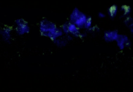 | 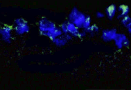 | 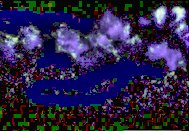 | 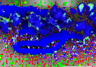 |
| Unadjusted | Contrast limit: 5 | Contrast limit: 5 · Gamma: 5 | Tiles per axis: 8 |

CLAHE + gamma uses the same CLAHE setting and the global-adjustment gamma value 5 (50 in its input field).

## Other methods

Expand a group to compare its results. Each image keeps the same coordinates and native 189 × 131 pixel dimensions.

Histogram and bi-histogram methods

| Histogram | BBHE |
| --- | --- |
| 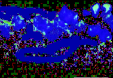 | 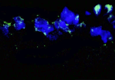 |
| Intensity: 100% | Intensity: 100% |

| DSIHE | MMBEBHE |
| --- | --- |
| 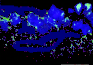 |  |
| Intensity: 100% | Intensity: 100% |

Recursive and weighted methods

| RMSHE | RSIHE |
| --- | --- |
| 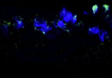 | 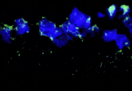 |
| Depth: 2 | Depth: 2 |

| RSWHE-M | RSWHE-D |
| --- | --- |
| 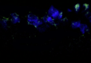 | 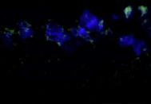 |
| Depth: 2 · mean split | Depth: 2 · median split |

| WTHE |
| --- |
| 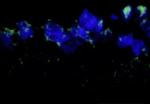 |
| Weighting exponent: 0.5 |

Dynamic and exposure-based methods

| DHE | BPDHE |
| --- | --- |
| 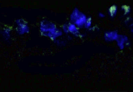 | 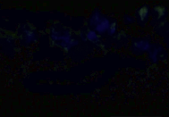 |
| Count emphasis: 0 | Histogram smoothing σ: 1.0762 |

| ESIHE |
| --- |
| 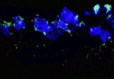 |
| Clip factor: 1 |

Contextual contrast and adaptive gamma

| CVC | AGCWD |
| --- | --- |
| 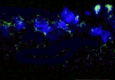 |  |
| Neighbourhood: 7 px | Weighting α: 0.5 |

DHE and BPDHE are experimental digital reconstructions. [Method conventions and original references](METHODS.md).

## Image source

Reinehr et al., *Scientific Reports* **8**, 9821 (2018), Figure 4A (page 6, third image in the upper row). [Archived PDF](sources/reinehr-2018-s100b/s41598-018-28183-6.pdf#page=6) · [Original article](https://doi.org/10.1038/s41598-018-28183-6) · [Full attribution and CC BY 4.0 licence](sources/reinehr-2018-s100b/README.md).

The examples show a crop and the named display adjustments. The archived PDF is unchanged.
