# DTD / DocTamper — five synthetic document pairs

These ten images form **five matched pairs of synthetic documents in English**, each before and after a text edit. They are rendered fictional documents, not ten independent real scans. The native 512 × 512 JPEGs were analyzed by the SHERLOQ browser engine using Chromium/WebGPU, at the fixed 0.5 threshold, without resizing, training or adjustment after seeing the results.

| What the percentage means | English DTD examples |
| --- | ---: |
| Among edited pixels, those correctly detected | 36.50% |
| Among unedited pixels, those incorrectly flagged | 0.0308% |
| Among pixels flagged as edited, those actually edited | 75.26% |
| Across all pixels, correct decisions | 99.81% |

DTD partly overlaps four of the five edits and entirely misses the single-digit replacement. Four of the five unchanged controls contain at least one falsely flagged pixel. The demonstration’s “any pixel ≥ 0.5” document alarm is a derived rule, not a native DTD whole-image verdict.

**Only 0.256% of pixels are edited. Always answering “unedited” would already achieve 99.74% pixel accuracy. The 99.81% above is not general reliability.**

## Reading the figure

Controls are on the left and edited versions on the right. Each card shows the input with an external reference annotation, the retained model response on a fixed 0–1 colour scale, and a comparison with the known intervention mask.

The comparison colours require that known reference: green = detected edited pixels, red = false signals, yellow = missed edited pixels. Within these regions the figure blends 20% source and 80% comparison colour; elsewhere it preserves the input. The yellow box is an annotation, absent from the model input. These are documentary annotations, not an application's ability to know which pixels were really edited.

The ordinary tool opens with a colour heatmap and also offers a colour overlay. Display threshold (initially 0.5) and overlay opacity (initially 70%) do not change the retained scores or native mask. While dragging, the controls use a small cached proxy; release restores the precise view. The fixed colour anchors are #070F27, #2A2A6D, #CF423B, #FBB135 and #FFF8C9 at 0, 0.25, 0.5, 0.75 and 1. There is no reference-mask input or per-image normalization.

## Original publication

Qu et al., [*Towards Robust Tampered Text Detection in Document Image: New Dataset and New Solution*](https://openaccess.thecvf.com/content/CVPR2023/papers/Qu_Towards_Robust_Tampered_Text_Detection_in_Document_Image_New_Dataset_CVPR_2023_paper.pdf), CVPR 2023, Table 4, report the following for DTD. These use the authors’ datasets and protocol, independently of the synthetic examples above.

| Original test set | Edited pixels found (R) | Correct among flagged pixels (P) |
| --- | ---: | ---: |
| DocTamper — Test | 77.1% | 81.4% |
| DocTamper-FCD | 78.6% | 84.9% |
| DocTamper-SCD | 76.2% | 74.5% |

## Detailed results

Pixel counts are pooled across all ten images. Unweighted means on the five edited documents are **30.11% recall and 60.72% precision**. They use a different aggregation and do not describe generalization to other documents. [Exact per-document counts and metrics](evaluation.json).

| Pair | Intervention | Edited pixels found | False pixels on the control |
| --- | --- | ---: | ---: |
| 1. INVOICE | Amount replaced using the same font and size. | 9.80% | 0 |
| 2. RECEIPT | Amount copied from another line of the same receipt. | 52.21% | 29 |
| 3. PURCHASE ORDER | Reference replaced with a separately JPEG Q75-compressed patch. | 1.73% | 363 |
| 4. CERTIFICATE | Date replaced using a slightly different font. | 86.80% | 40 |
| 5. TRANSACTION STATEMENT | One digit replaced; the rest of the field is unchanged. | 0.00% | 5 |

## Inputs, maps and reproduction

[Dataset protocol, intervention rectangles, order and file hashes](dataset.json) · [Pooled and per-document counts](evaluation.json).

Each numbered pair below provides its native input, input annotation, heatmap, comparison, exact intervention mask, numerical Float32 map and validity map. All ten examples are retained; no example or threshold was selected after inference. Ground truth marks the complete intervention rectangle, including its background; JPEG ringing outside the rectangle remains negative.

1. INVOICE — unchanged control

| Input and reference annotation | Heatmap | Comparison with the known reference |
| --- | --- | --- |
|  |  | [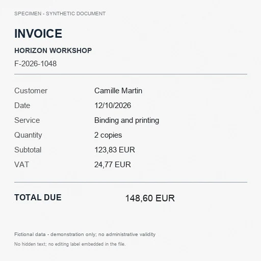](views/doc-01-a-errors-zoom.png) |

[Native JPEG](data/doc-01-a.jpg) · [Reference mask](data/doc-01-a-reference.png) · [Predicted mask, threshold 0.5](views/doc-01-a-mask.png) · [Float32 response](raw/doc-01-a.f32) · [Validity](raw/doc-01-a-valid.u8). The numerical maps use row-major 512 × 512 arrays; Float32 files are little-endian and validity is uint8.

1. INVOICE — edited

| Input and reference annotation | Heatmap | Comparison with the known reference |
| --- | --- | --- |
| [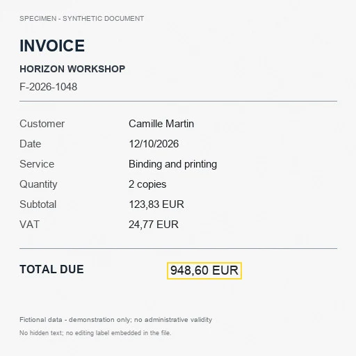](data/doc-01-b.jpg) |  | [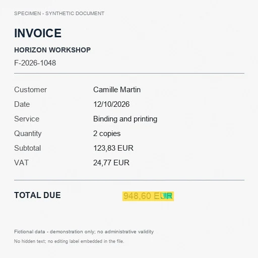](views/doc-01-b-errors-zoom.png) |

[Native JPEG](data/doc-01-b.jpg) · [Reference mask](data/doc-01-b-reference.png) · [Predicted mask, threshold 0.5](views/doc-01-b-mask.png) · [Float32 response](raw/doc-01-b.f32) · [Validity](raw/doc-01-b-valid.u8). The numerical maps use row-major 512 × 512 arrays; Float32 files are little-endian and validity is uint8.

2. RECEIPT — unchanged control

| Input and reference annotation | Heatmap | Comparison with the known reference |
| --- | --- | --- |
| [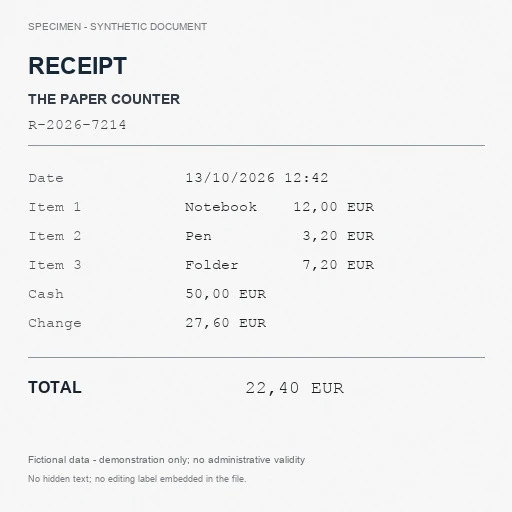](data/doc-02-a.jpg) |  | [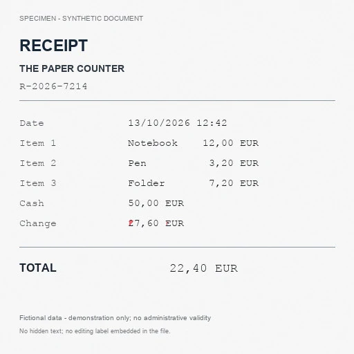](views/doc-02-a-errors-zoom.png) |

[Native JPEG](data/doc-02-a.jpg) · [Reference mask](data/doc-02-a-reference.png) · [Predicted mask, threshold 0.5](views/doc-02-a-mask.png) · [Float32 response](raw/doc-02-a.f32) · [Validity](raw/doc-02-a-valid.u8). The numerical maps use row-major 512 × 512 arrays; Float32 files are little-endian and validity is uint8.

2. RECEIPT — edited

| Input and reference annotation | Heatmap | Comparison with the known reference |
| --- | --- | --- |
| [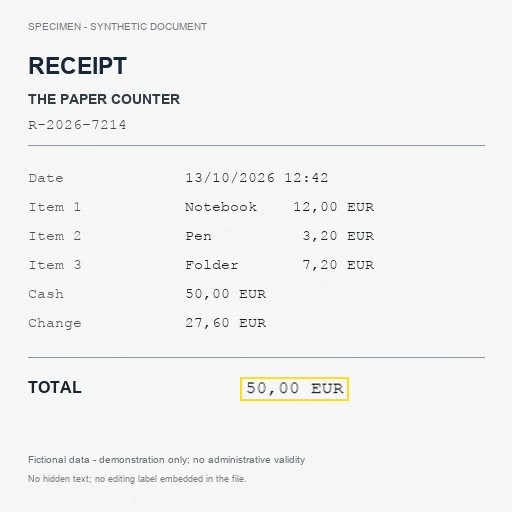](data/doc-02-b.jpg) |  | [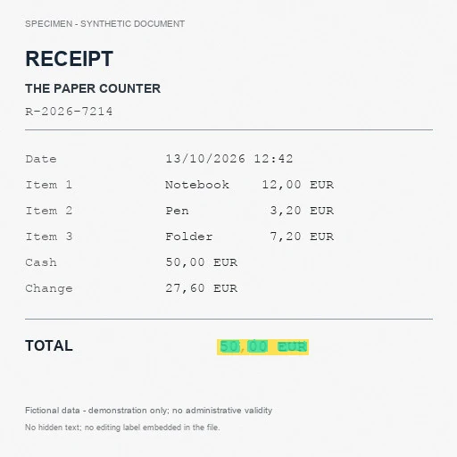](views/doc-02-b-errors-zoom.png) |

[Native JPEG](data/doc-02-b.jpg) · [Reference mask](data/doc-02-b-reference.png) · [Predicted mask, threshold 0.5](views/doc-02-b-mask.png) · [Float32 response](raw/doc-02-b.f32) · [Validity](raw/doc-02-b-valid.u8). The numerical maps use row-major 512 × 512 arrays; Float32 files are little-endian and validity is uint8.

3. PURCHASE ORDER — unchanged control

| Input and reference annotation | Heatmap | Comparison with the known reference |
| --- | --- | --- |
| [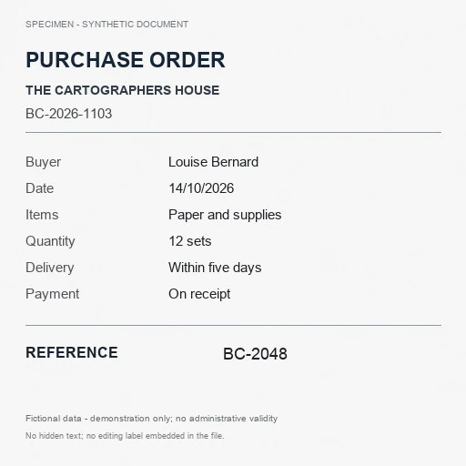](data/doc-03-a.jpg) |  | [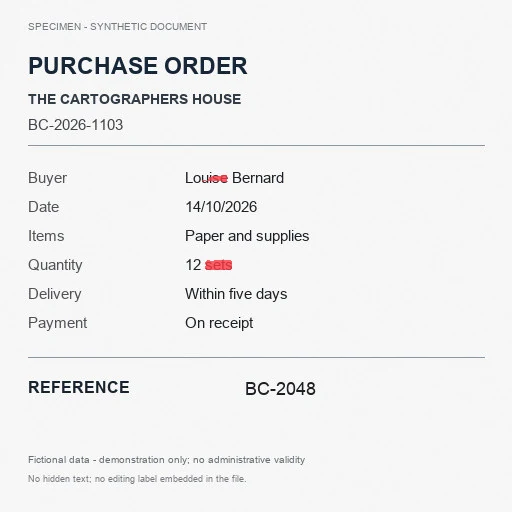](views/doc-03-a-errors-zoom.png) |

[Native JPEG](data/doc-03-a.jpg) · [Reference mask](data/doc-03-a-reference.png) · [Predicted mask, threshold 0.5](views/doc-03-a-mask.png) · [Float32 response](raw/doc-03-a.f32) · [Validity](raw/doc-03-a-valid.u8). The numerical maps use row-major 512 × 512 arrays; Float32 files are little-endian and validity is uint8.

3. PURCHASE ORDER — edited

| Input and reference annotation | Heatmap | Comparison with the known reference |
| --- | --- | --- |
| [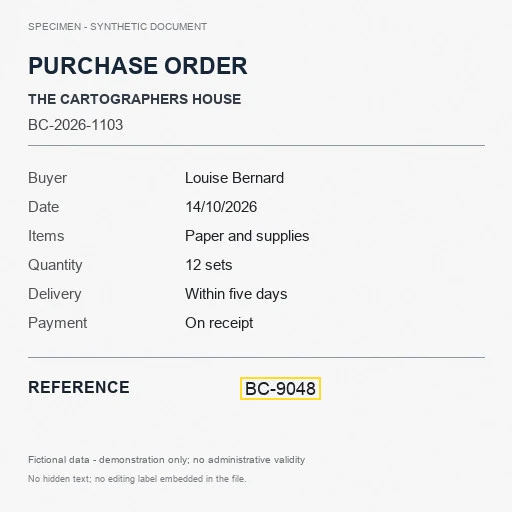](data/doc-03-b.jpg) | [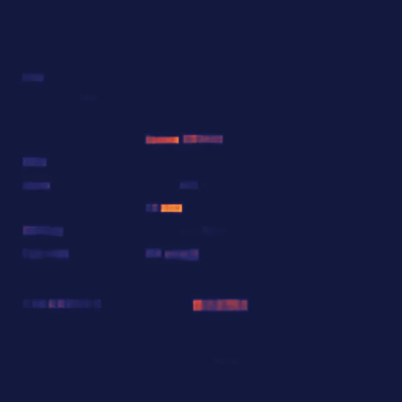](views/doc-03-b-heat-zoom.png) | [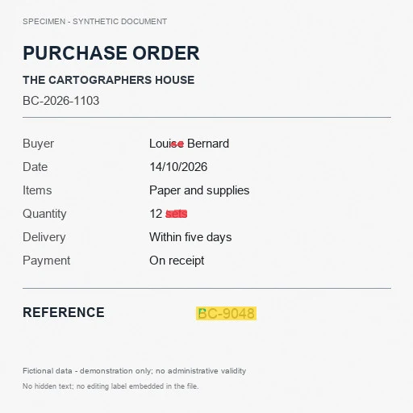](views/doc-03-b-errors-zoom.png) |

[Native JPEG](data/doc-03-b.jpg) · [Reference mask](data/doc-03-b-reference.png) · [Predicted mask, threshold 0.5](views/doc-03-b-mask.png) · [Float32 response](raw/doc-03-b.f32) · [Validity](raw/doc-03-b-valid.u8). The numerical maps use row-major 512 × 512 arrays; Float32 files are little-endian and validity is uint8.

4. CERTIFICATE — unchanged control

| Input and reference annotation | Heatmap | Comparison with the known reference |
| --- | --- | --- |
|  |  |  |

[Native JPEG](data/doc-04-a.jpg) · [Reference mask](data/doc-04-a-reference.png) · [Predicted mask, threshold 0.5](views/doc-04-a-mask.png) · [Float32 response](raw/doc-04-a.f32) · [Validity](raw/doc-04-a-valid.u8). The numerical maps use row-major 512 × 512 arrays; Float32 files are little-endian and validity is uint8.

4. CERTIFICATE — edited

| Input and reference annotation | Heatmap | Comparison with the known reference |
| --- | --- | --- |
| [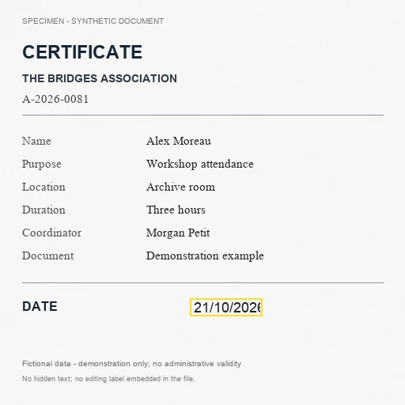](data/doc-04-b.jpg) | [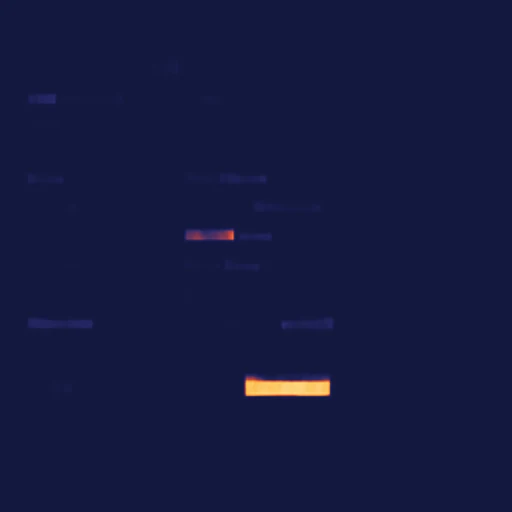](views/doc-04-b-heat-zoom.png) |  |

[Native JPEG](data/doc-04-b.jpg) · [Reference mask](data/doc-04-b-reference.png) · [Predicted mask, threshold 0.5](views/doc-04-b-mask.png) · [Float32 response](raw/doc-04-b.f32) · [Validity](raw/doc-04-b-valid.u8). The numerical maps use row-major 512 × 512 arrays; Float32 files are little-endian and validity is uint8.

5. TRANSACTION STATEMENT — unchanged control

| Input and reference annotation | Heatmap | Comparison with the known reference |
| --- | --- | --- |
| [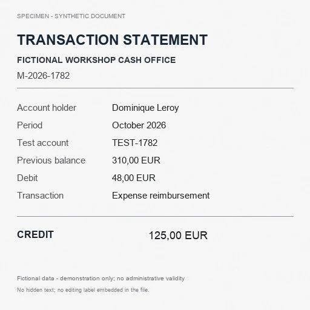](data/doc-05-a.jpg) |  |  |

[Native JPEG](data/doc-05-a.jpg) · [Reference mask](data/doc-05-a-reference.png) · [Predicted mask, threshold 0.5](views/doc-05-a-mask.png) · [Float32 response](raw/doc-05-a.f32) · [Validity](raw/doc-05-a-valid.u8). The numerical maps use row-major 512 × 512 arrays; Float32 files are little-endian and validity is uint8.

5. TRANSACTION STATEMENT — edited

| Input and reference annotation | Heatmap | Comparison with the known reference |
| --- | --- | --- |
| [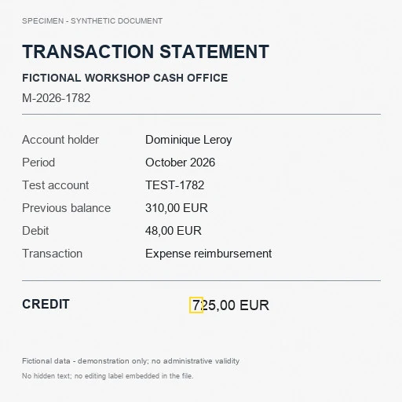](data/doc-05-b.jpg) | [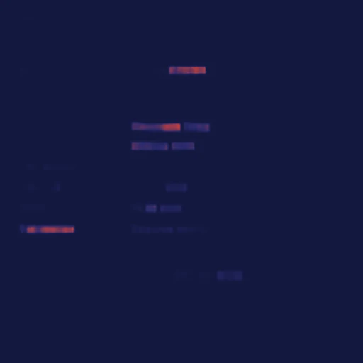](views/doc-05-b-heat-zoom.png) | [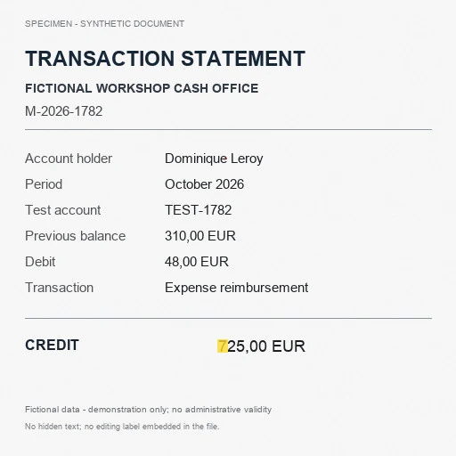](views/doc-05-b-errors-zoom.png) |

[Native JPEG](data/doc-05-b.jpg) · [Reference mask](data/doc-05-b-reference.png) · [Predicted mask, threshold 0.5](views/doc-05-b-mask.png) · [Float32 response](raw/doc-05-b.f32) · [Validity](raw/doc-05-b-valid.u8). The numerical maps use row-major 512 × 512 arrays; Float32 files are little-endian and validity is uint8.

`evaluate.py` recomputes the counts from the supplied raw maps and reference masks without running a model. `generate.py` describes the deterministic document construction; it requires Pillow, NumPy and the Arial, Arial Bold, Courier New and Times New Roman font files in the directory selected by `SHERLOQ_EXAMPLE_FONTS`. Font versions can change rendered pixels; the frozen JPEG inputs and hashes are the authoritative inputs for reproducing these detector results. Run the generator in a separate folder so it does not overwrite the frozen dataset.

DTD / DocTamper is credited to [Qu et al.](https://github.com/qcf-568/DocTamper). These small synthetic examples are not a reproduction of the publication’s benchmark and do not establish population accuracy.

