# Edit and control gallery

Image licence — All rights reserved. No reuse, commercial or non-commercial, is permitted.
[Image terms](../IMAGE-LICENCE.txt).

Both models analyse the same PNG files, with a maximum edge of 2,048 pixels for HEIC sources. RITA’s code was adapted to allow variable branch and output dimensions, using the same weights and without resizing to 512 × 512. Where required, reflection padding is added on the right and bottom to reach the next multiple of 32, then removed from the final mask.

[Open the interactive gallery](index.html) · [Read the mini-study](../mini-study-rita-trufor.md)

96 edited versions, 138 composite close-ups and 26 sources. The 25 HEIC controls and the before-intervention prototype are also retained. Each close-up contains, from left to right, Before, After and Edited regions. The regions are white, with a black border, on the before image.

After-edit maps: green = correctly detected edited region (TP); red = unedited region incorrectly flagged (FP); blue = missed edited region (FN); dark background = unedited region correctly left unflagged (TN).

## 2022-dsc0663_260522

### Clone stamp · five regions

| Before | Edited regions on the original | After |
| --- | --- | --- |
| [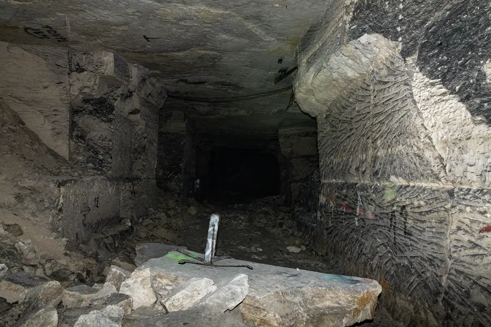](images/asset-4cd74debcf19efeed106c4f646658b365db2a67a09163d643094e4ef9e86a5a6.webp) | [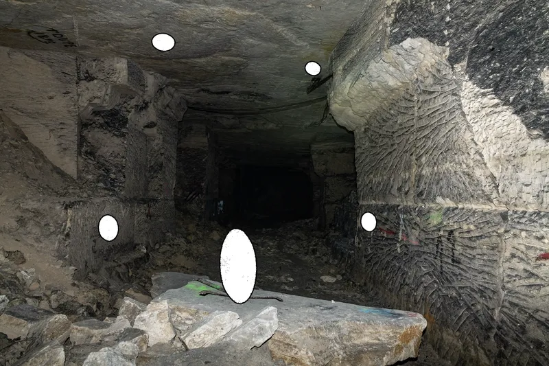](images/asset-2d2c13b18c5c53e5d930f71d30d47d3af88aceca5902878b282fea2cb9ed1b59.webp) | [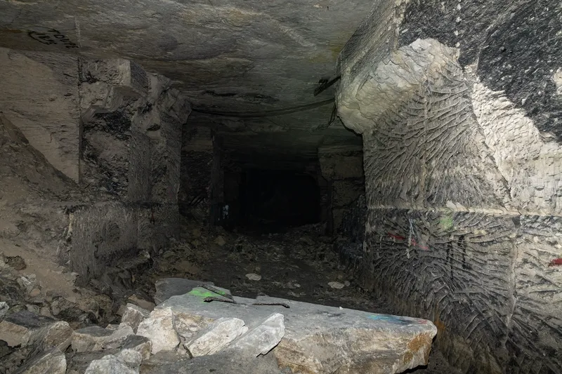](images/asset-431c3e4380a5c31cd044d1c292ffd08129bdebfcd97a195422f6bd4a359ec0d1.webp) |

**Region 1 — White vertical metal strip protruding from the foreground slab**

[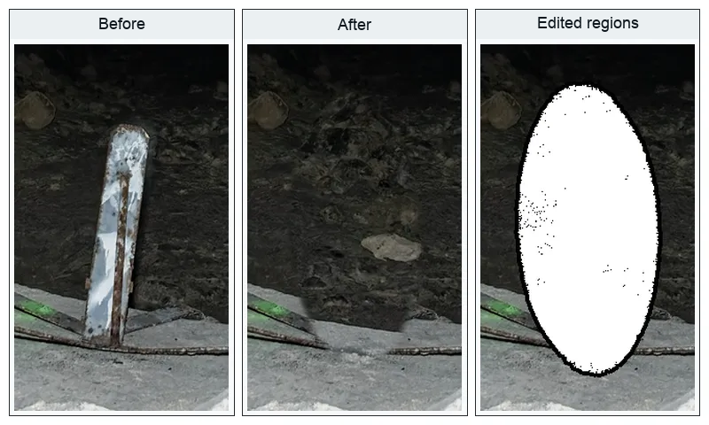](images/asset-858e57580f20782b6ff5abbbea82c34a4e388e12ad5f0ca47afac5de6d4bd7fa.webp)

**Region 2 — Small isolated black rectangular mount on the ceiling near the opening**

[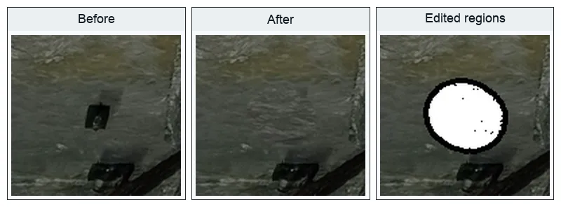](images/asset-064301679498ae8e43ae0b11cce594ede0a496147c9d580b83af8c24c155df9c.webp)

**Region 3 — Complete small orange paint spot and its short drip on the right-hand stone wall**

[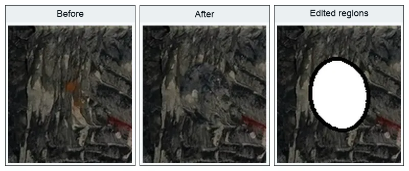](images/asset-ddcdcb366a5f39f4986ba6e401613590d1e86038f80e6395f957ff46b644cb94.webp)

**Region 4 — Small black painted number12 on the left stone wall**

[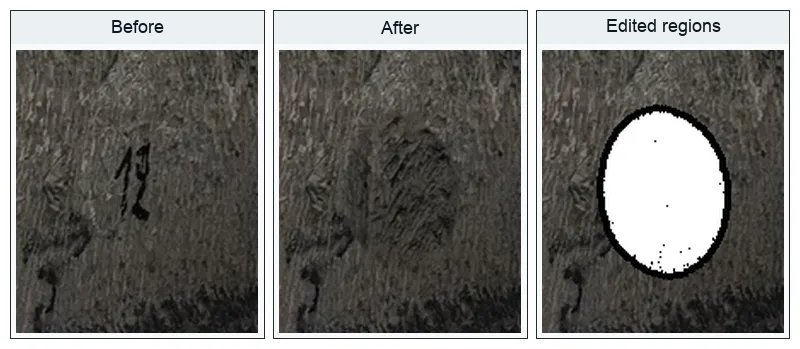](images/asset-d3756b0d4ad03d15c27392cc5e169192b6108cfe1fd6f0c91d15a6074d29c930.webp)

**Region 5 — Complete small black check-shaped painted mark on the ceiling**

[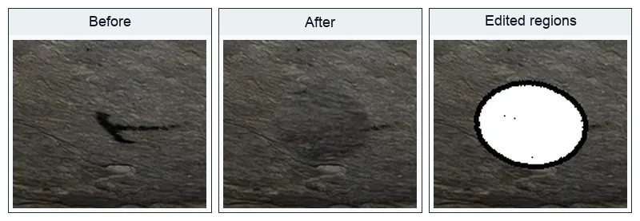](images/asset-859a70ad826965bbd24fcfbcffac40cdf8bdbfcf73b62bf3f560b202094e14ec.webp)

#### After-edit detection

| RITA | TruFor |
| --- | --- |
| [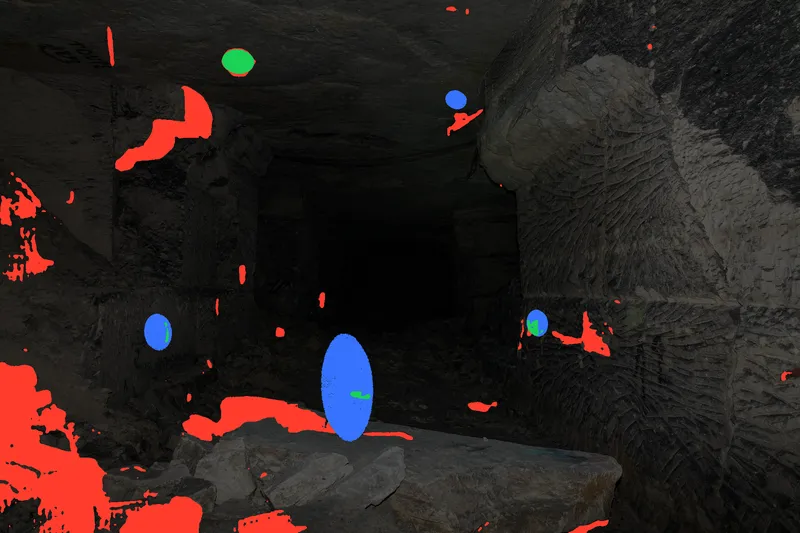](images/asset-76bcec159a3d7f1ed449d325ec081df2300ffa1d9466cc60419e529025772dee.webp) | [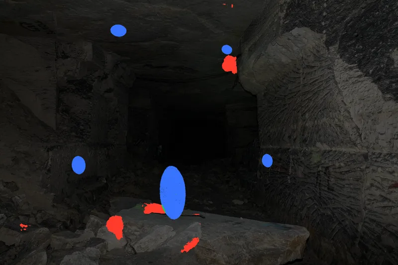](images/asset-2a0fc7ac1497b536a9c1a0da74f349ce48b5e3142202bd321976e41797a477c3.webp) |

Secondary after-edit comparison: [Official RITA · 512 × 512](images/asset-9e53894a602726bf2a4d00e431fe98f8220bc129e66b2671d03b296d1a0e9ede.webp).

### Raw clone stamp

| Before | Edited regions on the original | After |
| --- | --- | --- |
|  |  |  |

**Region 1 — White vertical metal strip protruding from the foreground slab**

#### After-edit detection

| RITA | TruFor |
| --- | --- |
| [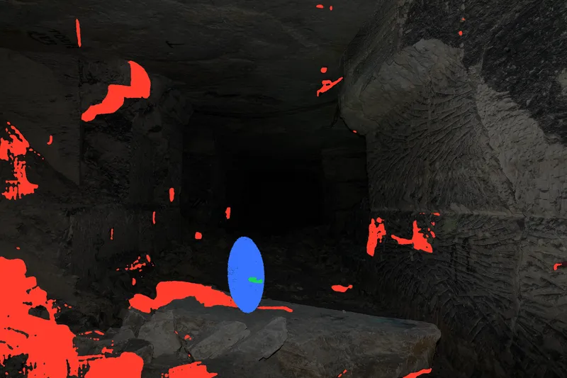](images/asset-f57531894b6992d7476893275e8a6cb572390a3bf4035066fd924fa46f976eb6.webp) |  |

Secondary after-edit comparison: [Official RITA · 512 × 512](images/asset-ecf19081d2d9d31c91a0673813d5577b432a0a7b3a59b60aeb0df7422ae2b6e8.webp).

### Clone stamp with Poisson blending

| Before | Edited regions on the original | After |
| --- | --- | --- |
|  | [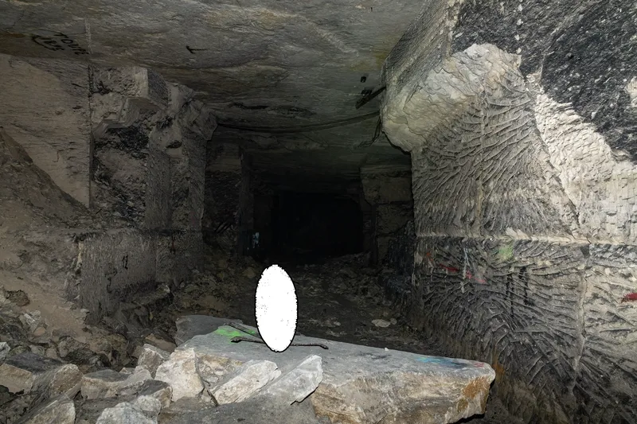](images/asset-bfd8b75ea9d75e6679a5829e04d47475303e66d440511fdcf92241ce33fe3e52.webp) | [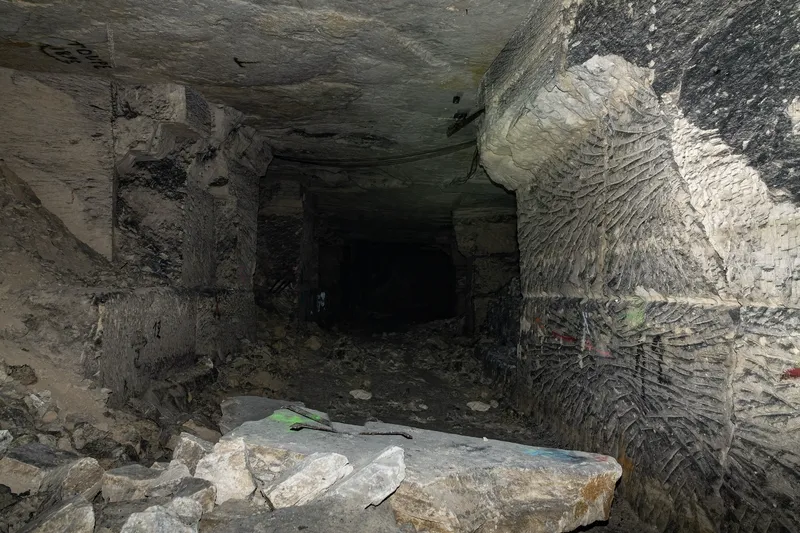](images/asset-75e4827e3a032fb96fbb98b31325bbdd988bbd75ab54ecf1af896145f063835d.webp) |

**Region 1 — White vertical metal strip protruding from the foreground slab**

[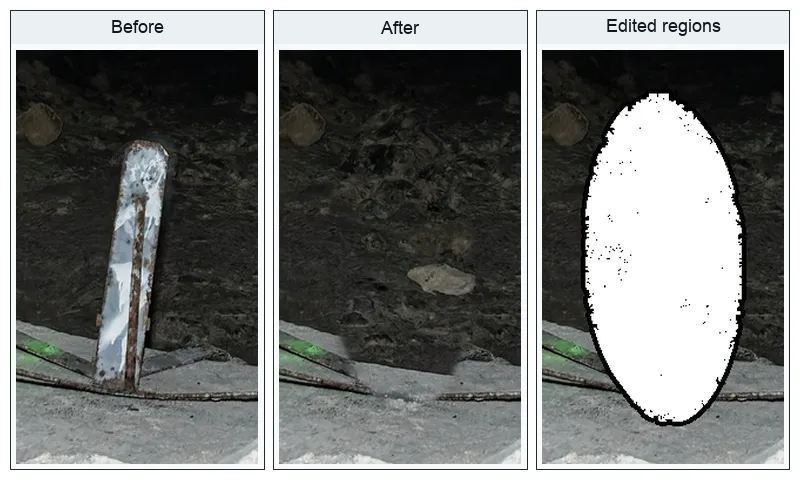](images/asset-86822ef57ab82348006922d1677e5dd2834530da59abd757a08ea433f9bd4f8a.webp)

#### After-edit detection

| RITA | TruFor |
| --- | --- |
| [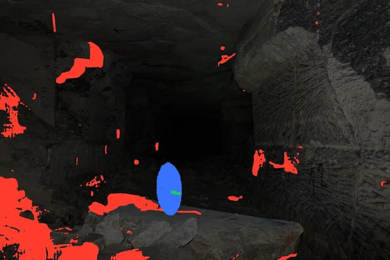](images/asset-8ab00c4a4fece39711ea868753308a47e106a491c6fef5770e62c8e5d1b0f70b.webp) | [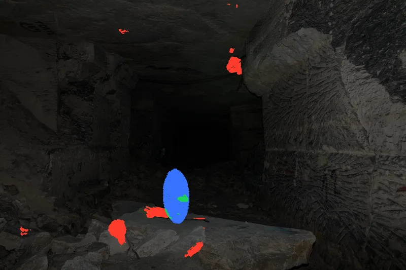](images/asset-9e8d5b98054133fd43d77145253b0d920ee961f2e09659eb3656f63c28620015.webp) |

Secondary after-edit comparison: [Official RITA · 512 × 512](images/asset-46039c3d40c66de1c0d8ff310fea8a84c8b9bfe864f3e36939eb5f6b549b4ae5.webp).

### Generative AI · attempt 1

| Before | Edited regions on the original | After |
| --- | --- | --- |
|  | [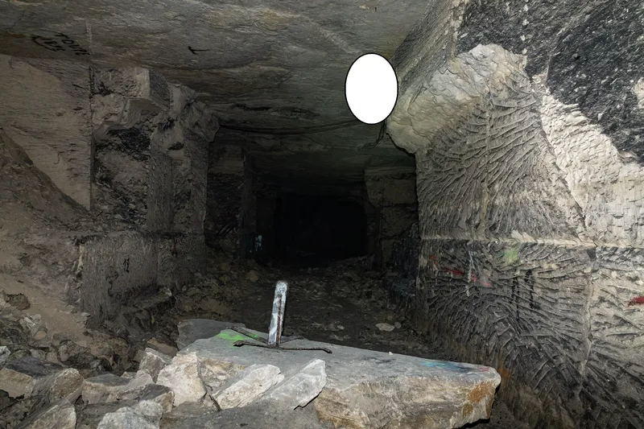](images/asset-3b39c634446d3f30637ed7fa08be059f74f8e5ce8161baad5bd8f8ed1610daef.webp) | [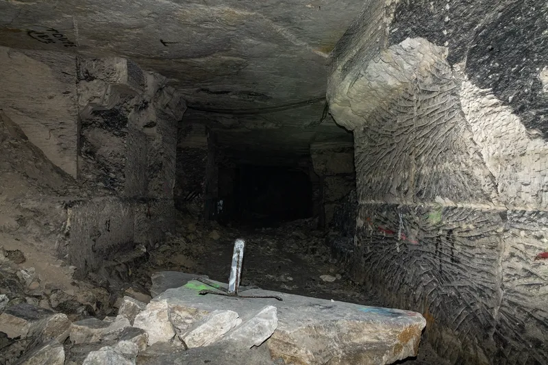](images/asset-340b64356fb7ab8bb487074f7050b4788d63af2d5657baf7c84cfb3796c0138d.webp) |

**Region 1 — Small protruding black fitting fixed in the upper right corner**

[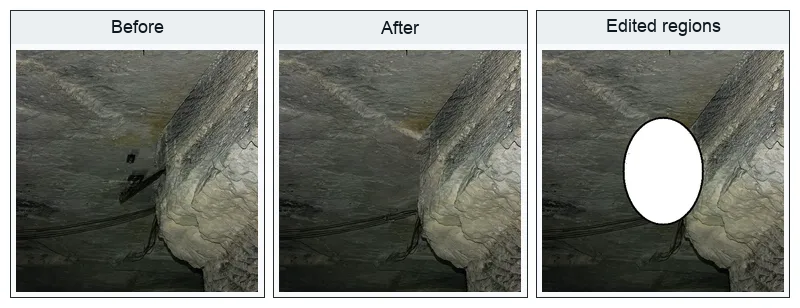](images/asset-1ddc15d41e6016483e8150ec60b2fbd468bcd2f71b8a6802023f90c0169cf0ed.webp)

#### After-edit detection

| RITA | TruFor |
| --- | --- |
| [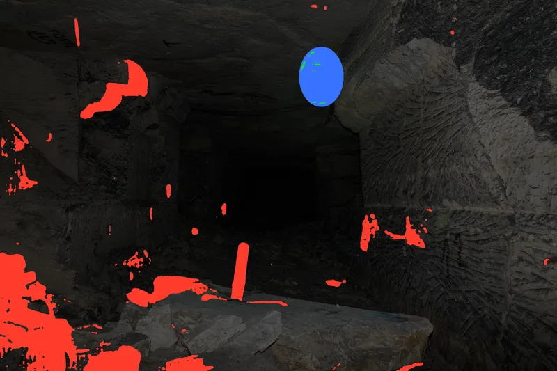](images/asset-5e40ce0fe50104c92716d6f80eb21b44a49b66f42b4b442df08e5ee482577148.webp) | [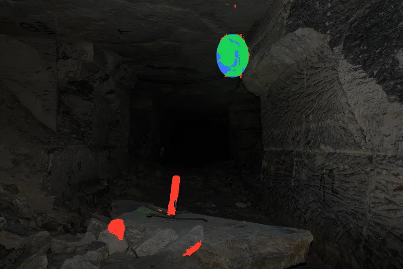](images/asset-f2ed07b30e5be078b8e88dd3b1e9ddea1f7ff58e7b2e60ba8f8e71788dac8c0a.webp) |

Secondary after-edit comparison: [Official RITA · 512 × 512](images/asset-8a0de32c2cd6a801141a6a158006832894547ccacca7a257e2bba5abe0e0121d.webp).

### Clone stamp and generative AI · mixed version

| Before | Edited regions on the original | After |
| --- | --- | --- |
|  | [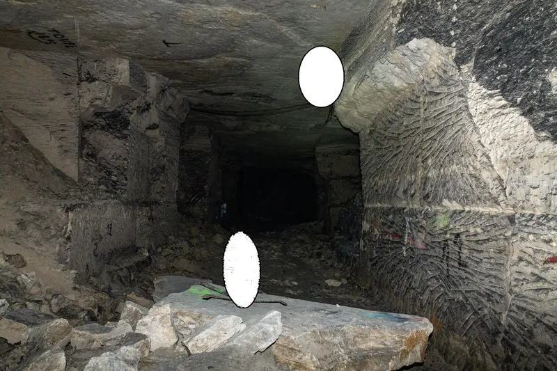](images/asset-86d45917baa73a7e93ed7b884c068b82fc2c884d3e87ecbb4695ff77479a2c13.webp) |  |

**Region 1 — White vertical metal strip protruding from the foreground slab**

**Region 2 — Small protruding black fitting fixed in the upper right corner**

#### After-edit detection

| RITA | TruFor |
| --- | --- |
| [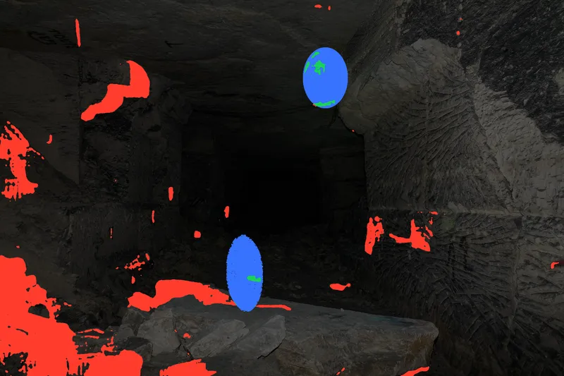](images/asset-e9c4edbac377e0a3bc0addcdb10bad955a8b9402e5af53c5f5e5921ab43e9a1d.webp) | [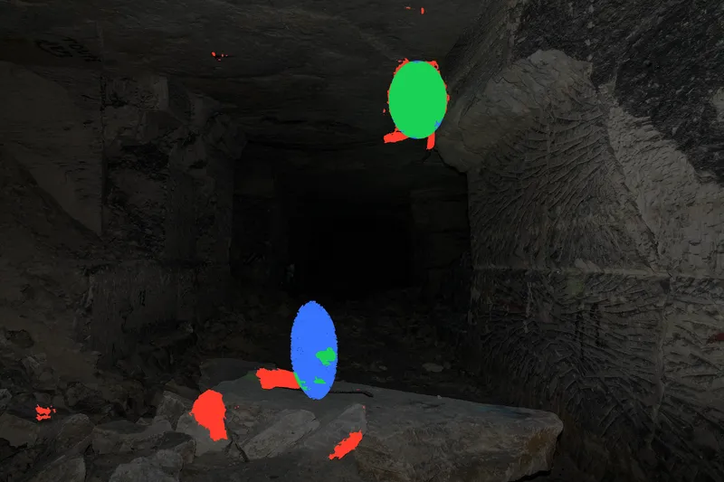](images/asset-4b24ecfd71bd95e89750713b31cdcc8d5cd513fbe4d29106394e4584bda44e99.webp) |

Secondary after-edit comparison: [Official RITA · 512 × 512](images/asset-a1d15a9a608b579a4f232211bf3304e659081dbf304f63ddd8cb3cde71e0f569.webp).

### Before-intervention detection · control

These views show detections on the source before intervention. They are not the results obtained on the edited versions shown above.

| Before | RITA | TruFor |
| --- | --- | --- |
|  | [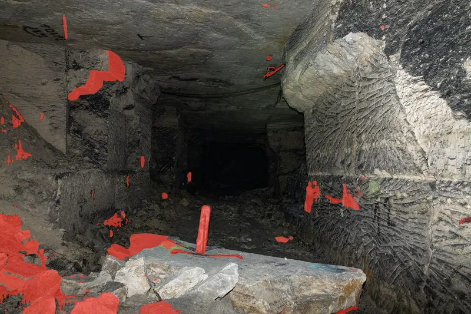](images/asset-858f339c9981da94dbaff4d3e9173755721a442c217cf2663ec676d0f2ebaff7.webp) | [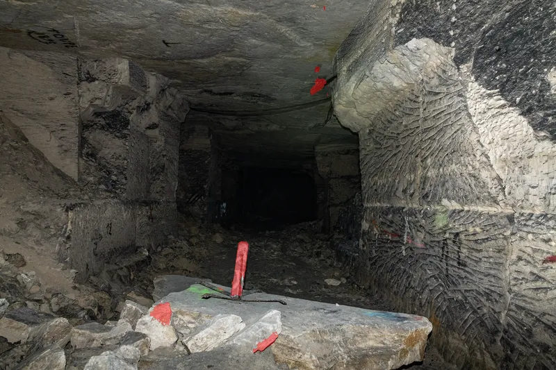](images/asset-daecc6c2210b8f25bdfc04684830b79e06948e069457a62f9c2c5bfec3459d03.webp) |

[Official RITA control map · 512 × 512](images/asset-c06c06efcc319bc80a6c9a118529448cdf322eed27326db5463c1b48160533a1.webp).

## 2022-dsc0666_260522

### Raw clone stamp

| Before | Edited regions on the original | After |
| --- | --- | --- |
|  | [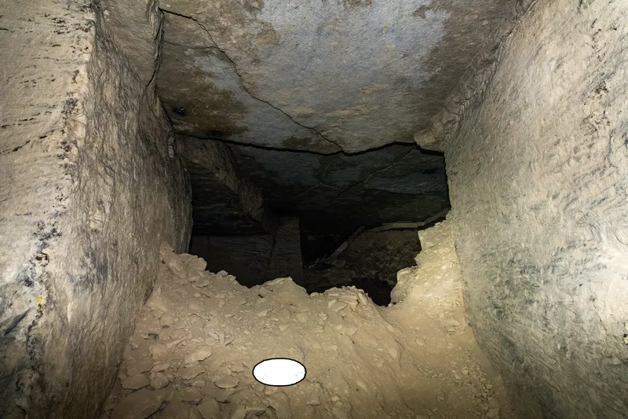](images/asset-04bc1f44af274a6cd7c350722f567da4dcb9ef93feff96a0723ffd793624bbe6.webp) |  |

**Region 1 — Single flat loose stone and its short dark edge on the foreground floor**

[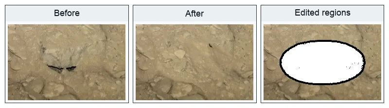](images/asset-038b0f7c40b12c84dbac218014721acc5efb7b00b1c307609c5f1decddb833b9.webp)

#### After-edit detection

| RITA | TruFor |
| --- | --- |
| [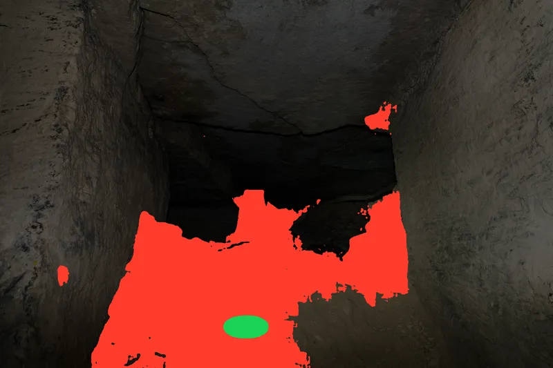](images/asset-8fe50197851a2d302fbda77da96ec1e2f2b63d12456052dc0d90bd1f6fd26a6e.webp) | [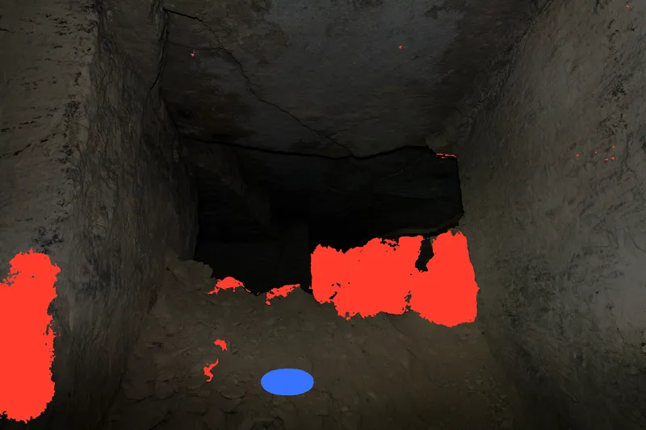](images/asset-6ae63f4a280604c8f5d81df07ea2c9d63c9a35ab1734fa4586d88c3fc84b56e7.webp) |

Secondary after-edit comparison: [Official RITA · 512 × 512](images/asset-709ec71ec9e93d4ca7d39cb4fdafe4aea99bacd8c07873ed0bee27e02db25581.webp).

### Clone stamp with Poisson blending

| Before | Edited regions on the original | After |
| --- | --- | --- |
|  | [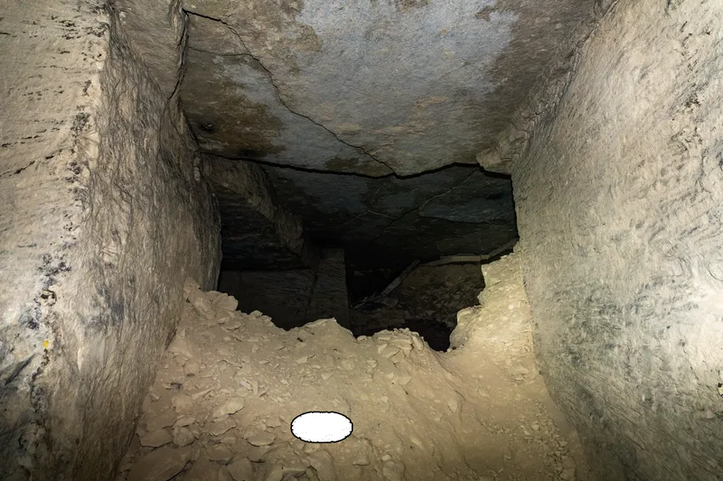](images/asset-f5d53c7b5413def85239230eb20d3293e73de08cd804bc97a2a54363d9b2d21b.webp) | [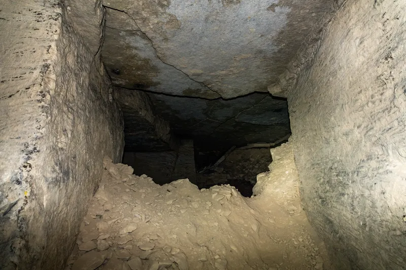](images/asset-765bed1921f01765c416b277061a40e4e18d4646896c7e059390f3df69e675a0.webp) |

**Region 1 — Single flat loose stone and its short dark edge on the foreground floor**

[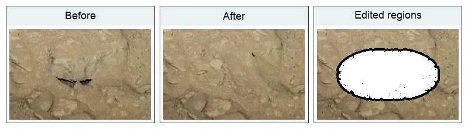](images/asset-46e309b978e280d37e43c1aed05ba83bcd0992a6f12c9651a7c4d22efb547807.webp)

#### After-edit detection

| RITA | TruFor |
| --- | --- |
| [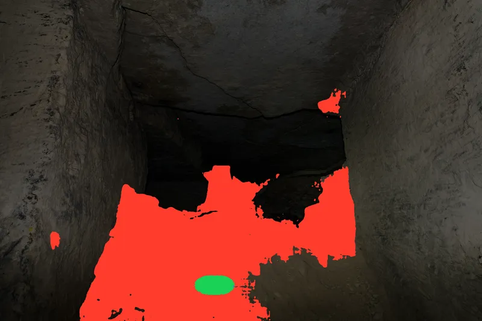](images/asset-3dfc94aaeed5891a46f2e54646599912e922e90777e91f905af12ca80422a49d.webp) | [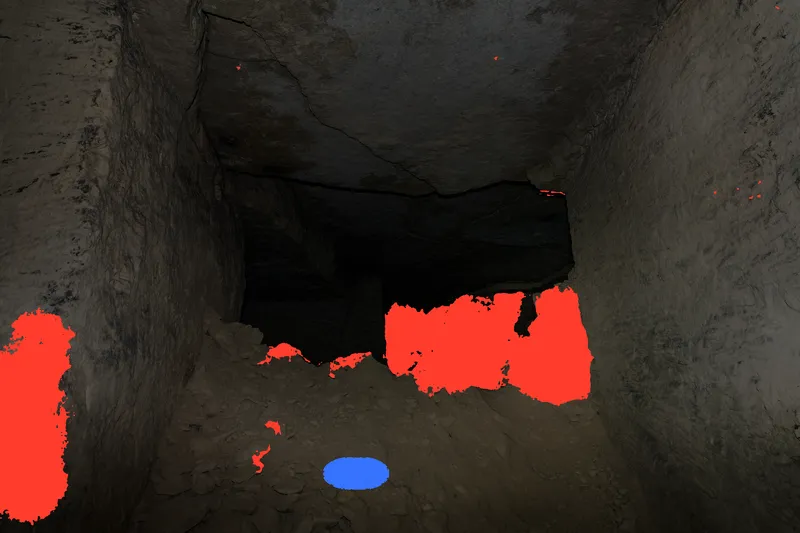](images/asset-a2b87825b2290420bc0aad260f6742960430ed9c68202259fcb9a95ee75f8416.webp) |

Secondary after-edit comparison: [Official RITA · 512 × 512](images/asset-da4631a9d0ebacc5a03c7de760646a3f82dc397cb804d7723655e9a2ff8ccfad.webp).

### Generative AI · attempt 1

| Before | Edited regions on the original | After |
| --- | --- | --- |
|  | [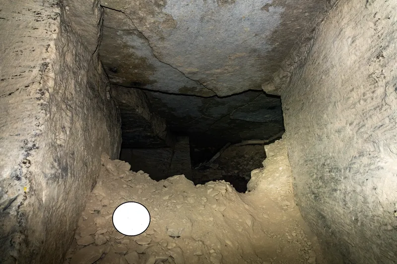](images/asset-dad16b0cd2cf281f6be5c88cc6899b434dbf6400b0851231d56e9fe411cc0d4c.webp) | [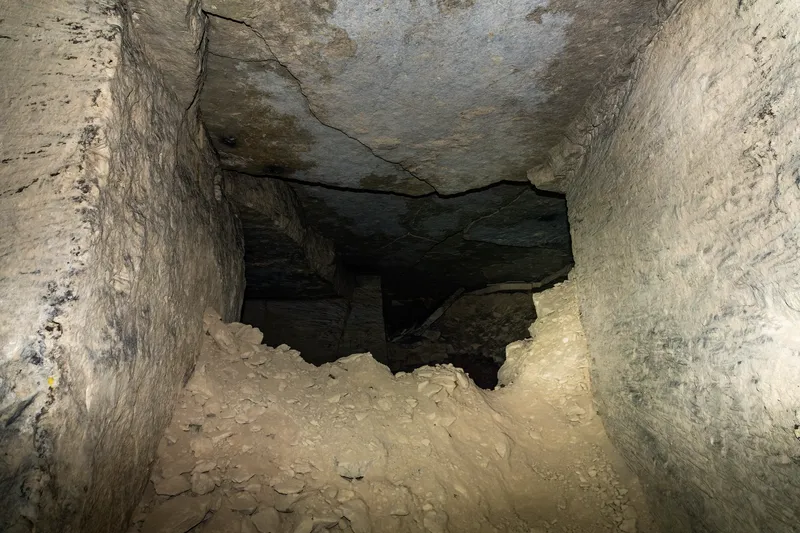](images/asset-57eba37dbf0a39d99cf0b32ea30c9868bcce08094a8e043d978a2669177dabcf.webp) |

**Region 1 — Small isolated beige stone at the lower left of the pile**

[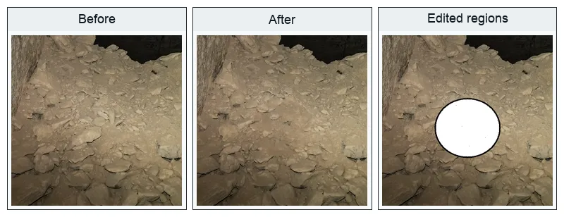](images/asset-b9b2c9cc2a64b98fc3d15743e451ff2f6a9bb8b01205ce2034e9e559b345bc1d.webp)

#### After-edit detection

| RITA | TruFor |
| --- | --- |
| [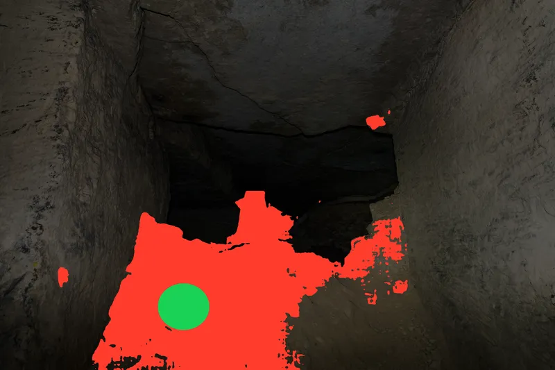](images/asset-4952dfd12fc2abdf045c4cc7b0e584e93136774816d837a715cd1993bb4de204.webp) | [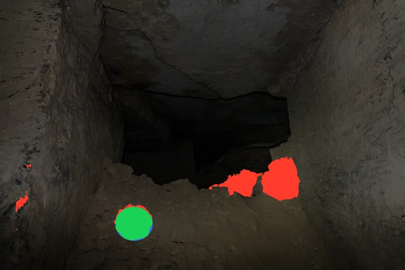](images/asset-375f5e6daadd91047d21da9476e82ce28d3258b980ab4c71bd7de554e9258771.webp) |

Secondary after-edit comparison: [Official RITA · 512 × 512](images/asset-3bede1a54fd3516d43c69075cd599a979df4788424377ffe47406e7cc2a73146.webp).

### Before-intervention detection · control

These views show detections on the source before intervention. They are not the results obtained on the edited versions shown above.

| Before | RITA | TruFor |
| --- | --- | --- |
|  | [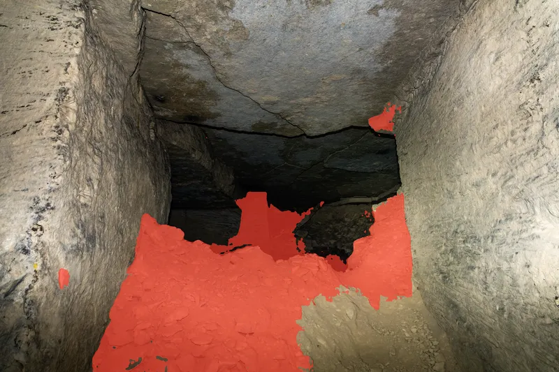](images/asset-e740745f9f6e0b993455e2fb94a42b11ac0d5318e6cfd221a1613a578b2957d8.webp) | [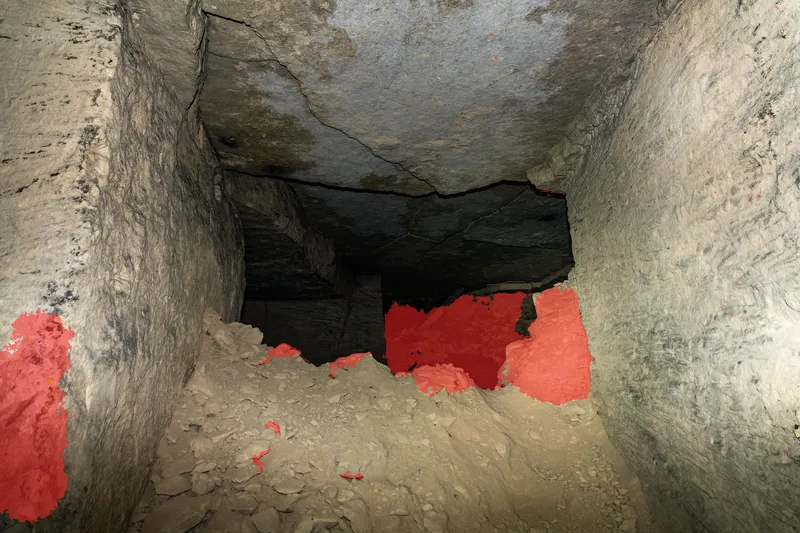](images/asset-4961f8ec312d8f37826844779fdb3fc38a87df930a762d0b960f2c7ce9147e7c.webp) |

[Official RITA control map · 512 × 512](images/asset-376c4fa0686b16a1fed5800f82d4cbc4b38b7ce2a456949c593743dc25d12a0a.webp).

## 2022-dsc0702_260522

### Raw clone stamp

| Before | Edited regions on the original | After |
| --- | --- | --- |
| [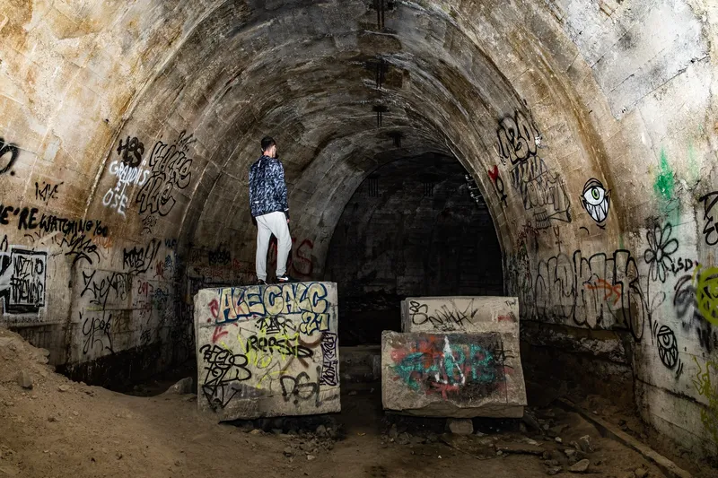](images/asset-3ea712867454a601e8ad98d4db01edefaa665a58701c76086c3dbf23bd030d15.webp) |  | [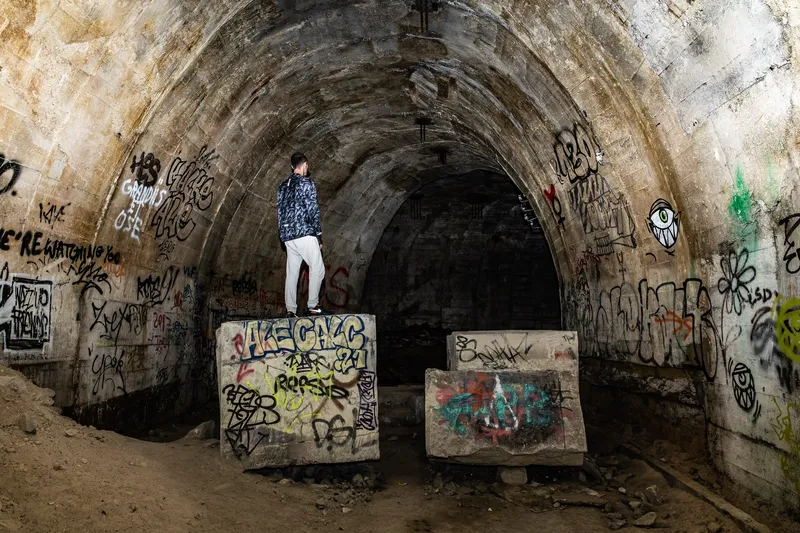](images/asset-66d629354666b374aeccb44865379543fcc919669ed63c8d1bddf9470af8e23c.webp) |

**Region 1 — One small black metal fitting hanging from the upper ceiling**

[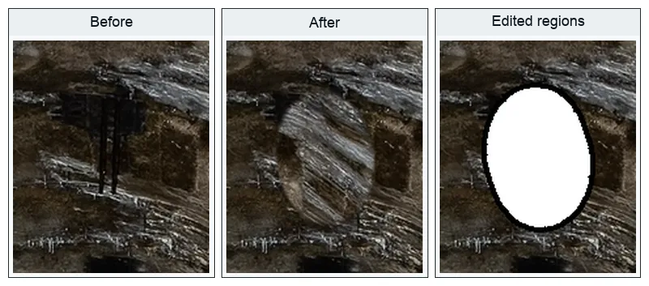](images/asset-a57add96db77f08b471cc4af03c95a088733c5c6acfd9af8003c7730b63b92d1.webp)

#### After-edit detection

| RITA | TruFor |
| --- | --- |
| [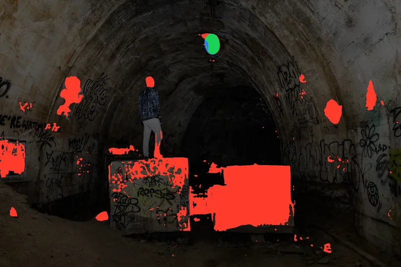](images/asset-b0816a1ab9dbdd232b98b9e5766f042203ce474e5143f0a9422438ceb70e31e5.webp) | [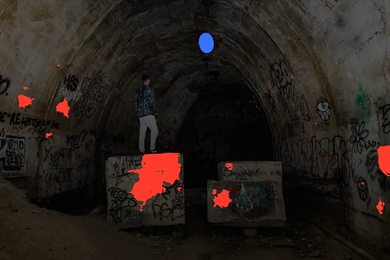](images/asset-6848de4f2eb30e261764f8e4d24475cbeb07fa8599be25c8f972f9be614e9b47.webp) |

Secondary after-edit comparison: [Official RITA · 512 × 512](images/asset-90abcd0895b669a294bd215c98360b82bab3e5b4026a9d99ecbbb15a8e9e14b3.webp).

### Clone stamp with Poisson blending

| Before | Edited regions on the original | After |
| --- | --- | --- |
|  | [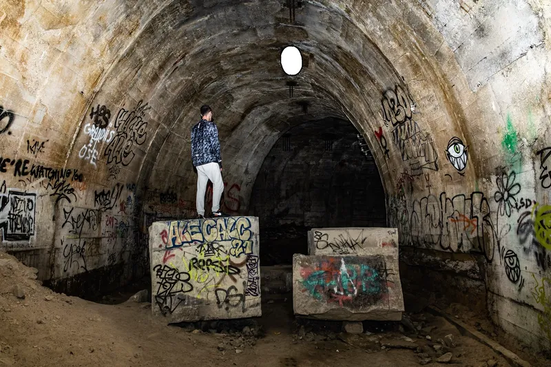](images/asset-a7ae278ee3dedab8d256959dc95f7f5d5b26d6220241a82e8e2e5dfe67258c94.webp) |  |

**Region 1 — One small black metal fitting hanging from the upper ceiling**

[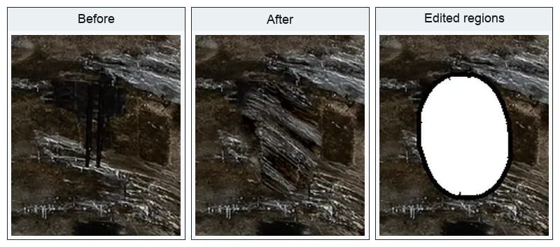](images/asset-929b07226436efe8b51c6a516f2f3b8495089f2fcf667afcde020a75aee5fa11.webp)

#### After-edit detection

| RITA | TruFor |
| --- | --- |
| [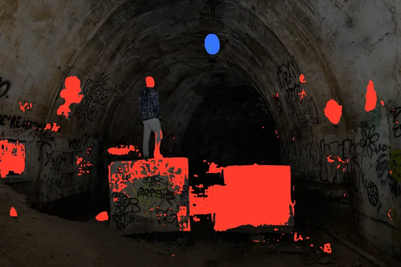](images/asset-ec0b09630bf79d5d77f0369bbf45d16800a44b1598cb52c4c3318263cfaa2eeb.webp) |  |

Secondary after-edit comparison: [Official RITA · 512 × 512](images/asset-20503588a5b3dd82a9fa56afc0e2c5cd0210ce00223249f399f63080591a02cf.webp).

### Generative AI · attempt 1

| Before | Edited regions on the original | After |
| --- | --- | --- |
|  |  |  |

**Region 1 — Whole person standing sideways on the block**

#### After-edit detection

| RITA | TruFor |
| --- | --- |
|  |  |

Secondary after-edit comparison: [Official RITA · 512 × 512](images/asset-100da4a31c23f2fb3f91dc1fe84fa2acdf05e5c5afb033c95bbf9104334f42ca.webp).

### Generative AI · attempt 2

| Before | Edited regions on the original | After |
| --- | --- | --- |
|  |  |  |

**Region 1 — Whole person standing sideways on the block**

#### After-edit detection

| RITA | TruFor |
| --- | --- |
|  |  |

Secondary after-edit comparison: [Official RITA · 512 × 512](images/asset-e75a30f22d67e6ae98a147d35fc3bc94f9ebb42e68b6b2ed247b587702586af1.webp).

### Before-intervention detection · control

These views show detections on the source before intervention. They are not the results obtained on the edited versions shown above.

| Before | RITA | TruFor |
| --- | --- | --- |
|  |  |  |

[Official RITA control map · 512 × 512](images/asset-6b061efaea03a3d435725a89b4357f2dfcb88bac1b2a8c90250c43157ea73e38.webp).

## 2022-dsc0713_260522

### Raw clone stamp

| Before | Edited regions on the original | After |
| --- | --- | --- |
|  |  |  |

**Region 1 — One black ceiling fitting above the jumping person**

#### After-edit detection

| RITA | TruFor |
| --- | --- |
|  |  |

Secondary after-edit comparison: [Official RITA · 512 × 512](images/asset-cdf11abff3a3584e51c9ebc5dc59f8ed9bfda89a1572da1d6c94cb37013a4ee3.webp).

### Clone stamp with Poisson blending

| Before | Edited regions on the original | After |
| --- | --- | --- |
|  |  |  |

**Region 1 — One black ceiling fitting above the jumping person**

#### After-edit detection

| RITA | TruFor |
| --- | --- |
|  |  |

Secondary after-edit comparison: [Official RITA · 512 × 512](images/asset-c7913a8b738e09759f57ed00f4bc88858e0c2d94bced6c50839955b6664de856.webp).

### Generative AI · attempt 1

| Before | Edited regions on the original | After |
| --- | --- | --- |
|  |  |  |

**Region 1 — Whole person mid-jump, seen from behind**

#### After-edit detection

| RITA | TruFor |
| --- | --- |
|  |  |

Secondary after-edit comparison: [Official RITA · 512 × 512](images/asset-c1a46c1c5234e2d58ee9425f5b3f379df9eafbe043023e871b33d07d1183a996.webp).

### Generative AI · attempt 2

| Before | Edited regions on the original | After |
| --- | --- | --- |
|  |  |  |

**Region 1 — Whole person mid-jump, seen from behind**

#### After-edit detection

| RITA | TruFor |
| --- | --- |
|  |  |

Secondary after-edit comparison: [Official RITA · 512 × 512](images/asset-949c99490168422ed4946fb8dbcf83da786395c1af4af7c7f8721ea3bf3a3cf7.webp).

### Before-intervention detection · control

These views show detections on the source before intervention. They are not the results obtained on the edited versions shown above.

| Before | RITA | TruFor |
| --- | --- | --- |
|  |  |  |

[Official RITA control map · 512 × 512](images/asset-18f941457f72b1cf738db50020ae904a21f705d2bf64ec518c1d3a6ee67ddf8a.webp).

## 2022-dsc0727_260522

### Clone stamp · five regions

| Before | Edited regions on the original | After |
| --- | --- | --- |
|  |  |  |

**Region 1 — Complete small orange-and-white discarded carton on the foreground floor**

**Region 2 — Complete isolated small beige floor stone in the lower right foreground**

**Region 3 — Complete small group of red and white discarded packaging by the right wall**

**Region 4 — Complete small black metal fitting on the high ceiling**

**Region 5 — Complete small black angular graffiti glyph painted on the left wall**

#### After-edit detection

| RITA | TruFor |
| --- | --- |
|  |  |

Secondary after-edit comparison: [Official RITA · 512 × 512](images/asset-9585a7ffa976544ff9be22aaed0b1c81e674b8980c021680689bf7c044375492.webp).

### Raw clone stamp

| Before | Edited regions on the original | After |
| --- | --- | --- |
|  |  |  |

**Region 1 — Small orange-and-white discarded drink carton on the foreground floor**

#### After-edit detection

| RITA | TruFor |
| --- | --- |
|  |  |

Secondary after-edit comparison: [Official RITA · 512 × 512](images/asset-827e57c576b6f3a86efb59f17b258d85f7b276d4fe0817b0a6e8757dbbd75d80.webp).

### Clone stamp with Poisson blending

| Before | Edited regions on the original | After |
| --- | --- | --- |
|  |  |  |

**Region 1 — Small orange-and-white discarded drink carton on the foreground floor**

#### After-edit detection

| RITA | TruFor |
| --- | --- |
|  |  |

Secondary after-edit comparison: [Official RITA · 512 × 512](images/asset-52b6653e334ac3292f7e803e4b88fe155f78ebd9c2f16bc1cf1079bc764c194a.webp).

### Generative AI · attempt 1

| Before | Edited regions on the original | After |
| --- | --- | --- |
|  |  |  |

**Region 1 — White drawing of a head with teeth on the right wall**

#### After-edit detection

| RITA | TruFor |
| --- | --- |
|  |  |

Secondary after-edit comparison: [Official RITA · 512 × 512](images/asset-fd1210630f08e22f3bc2798a68f67ef7137b0ff2821aa9e4c2104c76203c9838.webp).

### Generative AI · attempt 2

| Before | Edited regions on the original | After |
| --- | --- | --- |
|  |  |  |

**Region 1 — White drawing of a head with teeth on the right wall**

#### After-edit detection

| RITA | TruFor |
| --- | --- |
|  |  |

Secondary after-edit comparison: [Official RITA · 512 × 512](images/asset-1035e6d9d1fd6a0caa23a435ee63da3ab3f4198e291b255ccab0dd906168a5ef.webp).

### Clone stamp and generative AI · mixed version

| Before | Edited regions on the original | After |
| --- | --- | --- |
|  |  |  |

**Region 1 — Small orange-and-white discarded drink carton on the foreground floor**

**Region 2 — White drawing of a head with teeth on the right wall**

#### After-edit detection

| RITA | TruFor |
| --- | --- |
|  |  |

Secondary after-edit comparison: [Official RITA · 512 × 512](images/asset-7184ee6b08a6eb06ed273f986fc32094db251be7281cdd04975bc64b69155fdb.webp).

### Before-intervention detection · control

These views show detections on the source before intervention. They are not the results obtained on the edited versions shown above.

| Before | RITA | TruFor |
| --- | --- | --- |
|  |  |  |

[Official RITA control map · 512 × 512](images/asset-66b6d725e5080142e5690a800b581f8a6c438ed32ca2feeedf20c90eb94f2b8d.webp).

## 2022-dsc0867_260522

### Raw clone stamp

| Before | Edited regions on the original | After |
| --- | --- | --- |
|  |  |  |

**Region 1 — The complete rightmost rusty hanging rod, including its lower tip and nearby shadow**

#### After-edit detection

| RITA | TruFor |
| --- | --- |
|  |  |

Secondary after-edit comparison: [Official RITA · 512 × 512](images/asset-009a790e954a433b480c35fb89ee39d25392aeaa6027133314aa6141262e4c4d.webp).

### Clone stamp with Poisson blending

| Before | Edited regions on the original | After |
| --- | --- | --- |
|  |  |  |

**Region 1 — The complete rightmost rusty hanging rod, including its lower tip and nearby shadow**

#### After-edit detection

| RITA | TruFor |
| --- | --- |
|  |  |

Secondary after-edit comparison: [Official RITA · 512 × 512](images/asset-1016310aa04f30b4909a12c0065f2705eea782b033e57b2f8155abe03952b217.webp).

### Generative AI · attempt 1

| Before | Edited regions on the original | After |
| --- | --- | --- |
|  |  |  |

**Region 1 — Leftmost rusty metal rod and its shadow**

#### After-edit detection

| RITA | TruFor |
| --- | --- |
|  |  |

Secondary after-edit comparison: [Official RITA · 512 × 512](images/asset-c7f6a652ac5d1730e043a9de35dec0357061b5ac9cdf2f2863b47ab6579d7d70.webp).

### Generative AI · attempt 2

| Before | Edited regions on the original | After |
| --- | --- | --- |
|  |  |  |

**Region 1 — Leftmost rusty metal rod and its shadow**

#### After-edit detection

| RITA | TruFor |
| --- | --- |
|  |  |

Secondary after-edit comparison: [Official RITA · 512 × 512](images/asset-0daf3b1b7fdae00cb0823799d796e33b0da3f7c4bac09da68374b6c0e0b3daff.webp).

### Clone stamp and generative AI · mixed version

| Before | Edited regions on the original | After |
| --- | --- | --- |
|  |  |  |

**Region 1 — The complete rightmost rusty hanging rod, including its lower tip and nearby shadow**

**Region 2 — Leftmost rusty metal rod and its shadow**

#### After-edit detection

| RITA | TruFor |
| --- | --- |
|  |  |

Secondary after-edit comparison: [Official RITA · 512 × 512](images/asset-7aa504f5487bef8a647e560584909f1a1c230fa804fd2f74ea90fb8040d7dc8c.webp).

### Before-intervention detection · control

These views show detections on the source before intervention. They are not the results obtained on the edited versions shown above.

| Before | RITA | TruFor |
| --- | --- | --- |
|  |  |  |

[Official RITA control map · 512 × 512](images/asset-6d0840699a2c83e41246600c2c281c7e0294d667a09e7dc24c1406743b179e88.webp).

## 2022-dsc0873_260522

### Clone stamp · five regions

| Before | Edited regions on the original | After |
| --- | --- | --- |
|  |  |  |

**Region 1 — Complete small pale loose stone on the middle foreground floor**

**Region 2 — Complete isolated beige loose stone left of the main stone pile**

**Region 3 — Complete loose pale angular stone on the right of the foreground pile**

**Region 4 — Complete small brown flat fragment on the floor below the main stone pile**

**Region 5 — Complete small yellow DANY inscription on the far right pillar**

#### After-edit detection

| RITA | TruFor |
| --- | --- |
|  |  |

Secondary after-edit comparison: [Official RITA · 512 × 512](images/asset-b553d4679bcb8fc3540ee81ec35db46b76329c1110a6d71ca989e21a276c0df1.webp).

### Raw clone stamp

| Before | Edited regions on the original | After |
| --- | --- | --- |
|  |  |  |

**Region 1 — Small pale loose stone isolated on the mid-foreground floor**

#### After-edit detection

| RITA | TruFor |
| --- | --- |
|  |  |

Secondary after-edit comparison: [Official RITA · 512 × 512](images/asset-26c1fe36a7eeed22f5d4b7ff23dcbd2092f4ecddd318f62dc9d099b345a7386a.webp).

### Clone stamp with Poisson blending

| Before | Edited regions on the original | After |
| --- | --- | --- |
|  |  |  |

**Region 1 — Small pale loose stone isolated on the mid-foreground floor**

#### After-edit detection

| RITA | TruFor |
| --- | --- |
|  |  |

Secondary after-edit comparison: [Official RITA · 512 × 512](images/asset-952baeed7ab133ecc670ec6a8a78fca425bf3cc9a283798bfad3a9e836878172.webp).

### Generative AI · attempt 1

| Before | Edited regions on the original | After |
| --- | --- | --- |
|  |  |  |

**Region 1 — Large isolated white stone in the foreground, to the right of the small pile**

#### After-edit detection

| RITA | TruFor |
| --- | --- |
|  |  |

Secondary after-edit comparison: [Official RITA · 512 × 512](images/asset-bfc83b70c98343d1fd4f60849113529e1addb13fbc3ae24c8eedb96e240eab3b.webp).

### Clone stamp and generative AI · mixed version

| Before | Edited regions on the original | After |
| --- | --- | --- |
|  |  |  |

**Region 1 — Small pale loose stone isolated on the mid-foreground floor**

**Region 2 — Large isolated white stone in the foreground, to the right of the small pile**

#### After-edit detection

| RITA | TruFor |
| --- | --- |
|  |  |

Secondary after-edit comparison: [Official RITA · 512 × 512](images/asset-17a608ae2fa0b3cc37f2e2d1af9e3818d8863ec6ead16a89c851cbfb85047f47.webp).

### Before-intervention detection · control

These views show detections on the source before intervention. They are not the results obtained on the edited versions shown above.

| Before | RITA | TruFor |
| --- | --- | --- |
|  |  |  |

[Official RITA control map · 512 × 512](images/asset-cd3aa1504134af37ede1850211aea1ae170f4926ecad8b878a0abc50d12188dd.webp).

## 2022-dsc0880_260522

### Clone stamp · five regions

| Before | Edited regions on the original | After |
| --- | --- | --- |
|  |  |  |

**Region 1 — Round metal cap at the foot of the pillar**

**Region 2 — Loose printed paper or tile on the right-hand floor**

**Region 3 — Small isolated red paint or litter mark on the foreground floor**

**Region 4 — Whole isolated orange angular paint mark on the dark left background wall**

**Region 5 — Small complete black painted tag high on the pillar**

#### After-edit detection

| RITA | TruFor |
| --- | --- |
|  |  |

Secondary after-edit comparison: [Official RITA · 512 × 512](images/asset-30f5c1ed9363ec518d6aa8611fa745958d3d95bbf18cc89a0ae1f9ef198ee301.webp).

### Raw clone stamp

| Before | Edited regions on the original | After |
| --- | --- | --- |
|  |  |  |

**Region 1 — Small white pebble on the floor to the right of the pillar**

#### After-edit detection

| RITA | TruFor |
| --- | --- |
|  |  |

Secondary after-edit comparison: [Official RITA · 512 × 512](images/asset-4c2001e6cf190e7265481117f65aa9b0c5068e8f71914598742a61387fc6a4d2.webp).

### Clone stamp with Poisson blending

| Before | Edited regions on the original | After |
| --- | --- | --- |
|  |  |  |

**Region 1 — Small white pebble on the floor to the right of the pillar**

#### After-edit detection

| RITA | TruFor |
| --- | --- |
|  |  |

Secondary after-edit comparison: [Official RITA · 512 × 512](images/asset-1fe27cb14e51adc3232d046483cb1e0f6b4ce146d8abd42570c68bd0d74d3b07.webp).

### Generative AI · attempt 1

| Before | Edited regions on the original | After |
| --- | --- | --- |
|  |  |  |

**Region 1 — Upper red inscription and associated blue strokes on the pillar**

#### After-edit detection

| RITA | TruFor |
| --- | --- |
|  |  |

Secondary after-edit comparison: [Official RITA · 512 × 512](images/asset-195f3f35982d6ebef8c02448dc8a3d81d75b1b9c16b19e4f87614acf46dfbda5.webp).

### Before-intervention detection · control

These views show detections on the source before intervention. They are not the results obtained on the edited versions shown above.

| Before | RITA | TruFor |
| --- | --- | --- |
|  |  |  |

[Official RITA control map · 512 × 512](images/asset-2ea3b824eb3093f5665f7705aa924dd1bb3acfd8617eb5c048f652c9fc8aa59d.webp).

## 2022-dsc0884_260522

### Clone stamp · five regions

| Before | Edited regions on the original | After |
| --- | --- | --- |
|  |  |  |

**Region 1 — Isolated beige loose stone left of the foreground stone pile**

**Region 2 — Flat loose stone on the right foreground floor**

**Region 3 — Small purple paint spot on the ceiling**

**Region 4 — Complete small black TMT painted inscription on the right wall**

**Region 5 — Small complete rusted rectangular litter piece on the foreground floor**

#### After-edit detection

| RITA | TruFor |
| --- | --- |
|  |  |

Secondary after-edit comparison: [Official RITA · 512 × 512](images/asset-2020f2fdc65da4c7118f5861aeb42644639800f82907360a1d3efcc03f813032.webp).

### Raw clone stamp

| Before | Edited regions on the original | After |
| --- | --- | --- |
|  |  |  |

**Region 1 — Isolated beige loose stone on the floor left of the large foreground stone pile**

#### After-edit detection

| RITA | TruFor |
| --- | --- |
|  |  |

Secondary after-edit comparison: [Official RITA · 512 × 512](images/asset-4fa2e4d5836a654812e687784e85d65c9bb28fa3b3ab14c9fcfdf821ab9a377b.webp).

### Clone stamp with Poisson blending

| Before | Edited regions on the original | After |
| --- | --- | --- |
|  |  |  |

**Region 1 — Isolated beige loose stone on the floor left of the large foreground stone pile**

#### After-edit detection

| RITA | TruFor |
| --- | --- |
|  |  |

Secondary after-edit comparison: [Official RITA · 512 × 512](images/asset-fa92c292ef8e3f446f9a955ee5c79b25f7b9c176a606745e8d5cad044deaa30b.webp).

### Generative AI · attempt 1

| Before | Edited regions on the original | After |
| --- | --- | --- |
|  |  |  |

**Region 1 — White Bon Anniv / Nero inscription on the left wall**

#### After-edit detection

| RITA | TruFor |
| --- | --- |
|  |  |

Secondary after-edit comparison: [Official RITA · 512 × 512](images/asset-e3f6066fc16fb0b5dd5d5805de0d48b50cb0224cec7042f21f90a429f193b0e4.webp).

### Clone stamp and generative AI · mixed version

| Before | Edited regions on the original | After |
| --- | --- | --- |
|  |  |  |

**Region 1 — Isolated beige loose stone on the floor left of the large foreground stone pile**

**Region 2 — White Bon Anniv / Nero inscription on the left wall**

#### After-edit detection

| RITA | TruFor |
| --- | --- |
|  |  |

Secondary after-edit comparison: [Official RITA · 512 × 512](images/asset-b5b59163cf3139529289c5148a0fdb3e2f67147f931fce784d945e631518ef1c.webp).

### Before-intervention detection · control

These views show detections on the source before intervention. They are not the results obtained on the edited versions shown above.

| Before | RITA | TruFor |
| --- | --- | --- |
|  |  |  |

[Official RITA control map · 512 × 512](images/asset-81669262bf842255eecda4903218e6e961d3d205a65e25ea0f82defadec714fe.webp).

## 2022-dsc0890_260522

### Clone stamp · five regions

| Before | Edited regions on the original | After |
| --- | --- | --- |
|  |  |  |

**Region 1 — Whole black discarded cloth on the foreground floor**

**Region 2 — Whole purple pentagram on the light pillar**

**Region 3 — Complete small black painted word on the upper sandbag**

**Region 4 — Complete red DAMS painted inscription on the lower-right sandbag**

**Region 5 — Small discarded blue or silver can at the foot of the pillar**

#### After-edit detection

| RITA | TruFor |
| --- | --- |
|  |  |

Secondary after-edit comparison: [Official RITA · 512 × 512](images/asset-829c843f3b6724ea5307622d291fcd426c214b92b76440207e0471df72b55a4a.webp).

### Raw clone stamp

| Before | Edited regions on the original | After |
| --- | --- | --- |
|  |  |  |

**Region 1 — Small black discarded cloth or glove on the foreground floor**

#### After-edit detection

| RITA | TruFor |
| --- | --- |
|  |  |

Secondary after-edit comparison: [Official RITA · 512 × 512](images/asset-860944577d467c50dcda73a3acc19d9ee90b12b32d858ca13f84b8390ee004c1.webp).

### Clone stamp with Poisson blending

| Before | Edited regions on the original | After |
| --- | --- | --- |
|  |  |  |

**Region 1 — Small black discarded cloth or glove on the foreground floor**

#### After-edit detection

| RITA | TruFor |
| --- | --- |
|  |  |

Secondary after-edit comparison: [Official RITA · 512 × 512](images/asset-c227178c474247e8afd9c41b5b5bb1011897666c147040ea788d4fe5f97fc682.webp).

### Generative AI · attempt 1

| Before | Edited regions on the original | After |
| --- | --- | --- |
|  |  |  |

**Region 1 — Purple pentagram on the light face of the pillar**

#### After-edit detection

| RITA | TruFor |
| --- | --- |
|  |  |

Secondary after-edit comparison: [Official RITA · 512 × 512](images/asset-311b3671f47c8d3593d2bdf404b0847f7ecc9c9cb7b8e95e71ff95c9eff10e32.webp).

### Clone stamp and generative AI · mixed version

| Before | Edited regions on the original | After |
| --- | --- | --- |
|  |  |  |

**Region 1 — Small black discarded cloth or glove on the foreground floor**

**Region 2 — Purple pentagram on the light face of the pillar**

#### After-edit detection

| RITA | TruFor |
| --- | --- |
|  |  |

Secondary after-edit comparison: [Official RITA · 512 × 512](images/asset-4e84f20cb1c16c7bd302e1dc32ff0c9adc7af870ccf2c420cce19fdc6ab313a6.webp).

### Before-intervention detection · control

These views show detections on the source before intervention. They are not the results obtained on the edited versions shown above.

| Before | RITA | TruFor |
| --- | --- | --- |
|  |  |  |

[Official RITA control map · 512 × 512](images/asset-72137d8aba1e026190028c3c64f14589cdc61af47553317b3414e42efaaa2d52.webp).

## 2022-dsc0896_260522

### Raw clone stamp

| Before | Edited regions on the original | After |
| --- | --- | --- |
|  |  |  |

**Region 1 — Right-hand small black metal stub in a pair on the ceiling**

#### After-edit detection

| RITA | TruFor |
| --- | --- |
|  |  |

Secondary after-edit comparison: [Official RITA · 512 × 512](images/asset-929392e55f9a14a7f7f58551497f25ca60afb610d18a1b4ce0739abfbeafe79b.webp).

### Clone stamp with Poisson blending

| Before | Edited regions on the original | After |
| --- | --- | --- |
|  |  |  |

**Region 1 — Right-hand small black metal stub in a pair on the ceiling**

#### After-edit detection

| RITA | TruFor |
| --- | --- |
|  |  |

Secondary after-edit comparison: [Official RITA · 512 × 512](images/asset-252e531e7fbbf41cad63bb7c48ed51fb5c000e1ec53dbc3b3fdaf48ba21a9d53.webp).

### Generative AI · attempt 1

| Before | Edited regions on the original | After |
| --- | --- | --- |
|  |  |  |

**Region 1 — Two large loops of black paint on the right wall**

#### After-edit detection

| RITA | TruFor |
| --- | --- |
|  |  |

Secondary after-edit comparison: [Official RITA · 512 × 512](images/asset-d8c05fb397301debdd093788d64048d10af2e7a6529b8633f1cd71b67fdb4049.webp).

### Clone stamp and generative AI · mixed version

| Before | Edited regions on the original | After |
| --- | --- | --- |
|  |  |  |

**Region 1 — Right-hand small black metal stub in a pair on the ceiling**

**Region 2 — Two large loops of black paint on the right wall**

#### After-edit detection

| RITA | TruFor |
| --- | --- |
|  |  |

Secondary after-edit comparison: [Official RITA · 512 × 512](images/asset-1cd737757224e11a131bf5d65b7656e1d702d669cea9aa482ea9587944353708.webp).

### Before-intervention detection · control

These views show detections on the source before intervention. They are not the results obtained on the edited versions shown above.

| Before | RITA | TruFor |
| --- | --- | --- |
|  |  |  |

[Official RITA control map · 512 × 512](images/asset-b2b70b01fdb92e70dce75646dd70686a44f9c63ae126e13a258573831dd52eb0.webp).

## 2022-dsc0902_260522

### Clone stamp · five regions

| Before | Edited regions on the original | After |
| --- | --- | --- |
|  |  |  |

**Region 1 — Whole rusty T-shaped ceiling support**

**Region 2 — Whole red and white painted X on the front pillar**

**Region 3 — Small complete blue plastic ring on the left floor**

**Region 4 — Whole black discarded cloth or glove on the lower-left floor**

**Region 5 — Whole thin discarded white strip on the lower foreground floor**

#### After-edit detection

| RITA | TruFor |
| --- | --- |
|  |  |

Secondary after-edit comparison: [Official RITA · 512 × 512](images/asset-a352264fc11e01c301906215d4f4c2014ec99ae9d20ecbdab933247d03e7cca8.webp).

### Raw clone stamp

| Before | Edited regions on the original | After |
| --- | --- | --- |
|  |  |  |

**Region 1 — Rusty T-shaped metal bracket projecting from the ceiling**

#### After-edit detection

| RITA | TruFor |
| --- | --- |
|  |  |

Secondary after-edit comparison: [Official RITA · 512 × 512](images/asset-66b6a37eed821507151bac869744441b251f54bb6b34fc5e60894aeb962a3a8b.webp).

### Clone stamp with Poisson blending

| Before | Edited regions on the original | After |
| --- | --- | --- |
|  |  |  |

**Region 1 — Rusty T-shaped metal bracket projecting from the ceiling**

#### After-edit detection

| RITA | TruFor |
| --- | --- |
|  |  |

Secondary after-edit comparison: [Official RITA · 512 × 512](images/asset-4904c236b9bef864e3e97f5a951a563b9a5606ef58bb90a217a7fa688393eb82.webp).

### Generative AI · attempt 1

| Before | Edited regions on the original | After |
| --- | --- | --- |
|  |  |  |

**Region 1 — Blue drawing of a person on the rear wall on the right**

#### After-edit detection

| RITA | TruFor |
| --- | --- |
|  |  |

Secondary after-edit comparison: [Official RITA · 512 × 512](images/asset-db605de2af4adcd28da0411e9b52494795d97875bcb820ffd54b5305c6f51e93.webp).

### Generative AI · attempt 2

| Before | Edited regions on the original | After |
| --- | --- | --- |
|  |  |  |

**Region 1 — Blue drawing of a person on the rear wall on the right**

#### After-edit detection

| RITA | TruFor |
| --- | --- |
|  |  |

Secondary after-edit comparison: [Official RITA · 512 × 512](images/asset-e72f728c2f7cd60d458fcf064cce36382a9bc33e8f2c8877616fff06d6f872d1.webp).

### Before-intervention detection · control

These views show detections on the source before intervention. They are not the results obtained on the edited versions shown above.

| Before | RITA | TruFor |
| --- | --- | --- |
|  |  |  |

[Official RITA control map · 512 × 512](images/asset-ab06940c0b12ca3980000f15cb41303f4d2ae24c158f4f2ee9264bfa847512b5.webp).

## 2022-dsc7622_310822

### Raw clone stamp

| Before | Edited regions on the original | After |
| --- | --- | --- |
|  |  |  |

**Region 1 — Thin upright bright-green grass blade immediately behind the grasshopper head**

#### After-edit detection

| RITA | TruFor |
| --- | --- |
|  |  |

Secondary after-edit comparison: [Official RITA · 512 × 512](images/asset-d1d7ded272011df810492d4d0b6a00cebe4af9324fe478c4b2077ea634e8522b.webp).

### Clone stamp with Poisson blending

| Before | Edited regions on the original | After |
| --- | --- | --- |
|  |  |  |

**Region 1 — Thin upright bright-green grass blade immediately behind the grasshopper head**

#### After-edit detection

| RITA | TruFor |
| --- | --- |
|  |  |

Secondary after-edit comparison: [Official RITA · 512 × 512](images/asset-ec53f715ba0da5c5e1ac259118ae2a47db838ef14d7c80bec63a3990f6b4cf14.webp).

### Generative AI · attempt 1

| Before | Edited regions on the original | After |
| --- | --- | --- |
|  |  |  |

**Region 1 — Pale dry vertical stem on the left, throughout its visible extent**

#### After-edit detection

| RITA | TruFor |
| --- | --- |
|  |  |

Secondary after-edit comparison: [Official RITA · 512 × 512](images/asset-28c8dc5720d9d19ce5d04e00897315fe9e8594e44ac568841d00f1572bec32a4.webp).

### Generative AI · attempt 2

| Before | Edited regions on the original | After |
| --- | --- | --- |
|  |  |  |

**Region 1 — Pale dry vertical stem on the left, throughout its visible extent**

#### After-edit detection

| RITA | TruFor |
| --- | --- |
|  |  |

Secondary after-edit comparison: [Official RITA · 512 × 512](images/asset-4c904de389a5ea7daf4fd994f7e7068c761d7685732abe856d8783ba1841f116.webp).

### Before-intervention detection · control

These views show detections on the source before intervention. They are not the results obtained on the edited versions shown above.

| Before | RITA | TruFor |
| --- | --- | --- |
|  |  |  |

[Official RITA control map · 512 × 512](images/asset-982811da45ca57c334b9bdb1ea4a2d90493a80a3eb24529136e844b0dc1f0cb5.webp).

## 2022-dsc7634_310822

### Generative AI · attempt 1

| Before | Edited regions on the original | After |
| --- | --- | --- |
|  |  |  |

**Region 1 — Whole grasshopper, including its visible antennae and legs**

#### After-edit detection

| RITA | TruFor |
| --- | --- |
|  |  |

Secondary after-edit comparison: [Official RITA · 512 × 512](images/asset-4e93ce808678ad5ab441df15bbb08202a5fd673c8b5088edad3d6c990d3ba581.webp).

### Generative AI · attempt 2

| Before | Edited regions on the original | After |
| --- | --- | --- |
|  |  |  |

**Region 1 — Whole grasshopper, including its visible antennae and legs**

#### After-edit detection

| RITA | TruFor |
| --- | --- |
|  |  |

Secondary after-edit comparison: [Official RITA · 512 × 512](images/asset-4da25ef48dba85c5fc104ca3de84bfb124144f99e17c756696d85493d787de2e.webp).

### Before-intervention detection · control

These views show detections on the source before intervention. They are not the results obtained on the edited versions shown above.

| Before | RITA | TruFor |
| --- | --- | --- |
|  |  |  |

[Official RITA control map · 512 × 512](images/asset-1e33ef62cb872410c4b3958542013544dcc67aaa5b8dbb88a43925fbad182a4c.webp).

## 2022-dsc7637_310822

### Generative AI · attempt 1

| Before | Edited regions on the original | After |
| --- | --- | --- |
|  |  |  |

**Region 1 — Small brown insect on the dry leaf, including its appendages**

#### After-edit detection

| RITA | TruFor |
| --- | --- |
|  |  |

Secondary after-edit comparison: [Official RITA · 512 × 512](images/asset-cd10ff353134b69aae26dfdf213653a9e11ecaa2593579d79859fc44bd12e2fa.webp).

### Generative AI · attempt 2

| Before | Edited regions on the original | After |
| --- | --- | --- |
|  |  |  |

**Region 1 — Small brown insect on the dry leaf, including its appendages**

#### After-edit detection

| RITA | TruFor |
| --- | --- |
|  |  |

Secondary after-edit comparison: [Official RITA · 512 × 512](images/asset-84d4ece3447b259c75f5e148dc9b10ffe0e370330a1aa23af4f53362f5ef9480.webp).

### Before-intervention detection · control

These views show detections on the source before intervention. They are not the results obtained on the edited versions shown above.

| Before | RITA | TruFor |
| --- | --- | --- |
|  |  |  |

[Official RITA control map · 512 × 512](images/asset-9c80b1898ed6c3a771ff78584506bbbdf58fd686da4f764d97a9a53e7cece06e.webp).

## 2022-dsc7644_310822

### Generative AI · attempt 1

| Before | Edited regions on the original | After |
| --- | --- | --- |
|  |  |  |

**Region 1 — Small brown insect on the stem, including its long right antenna**

#### After-edit detection

| RITA | TruFor |
| --- | --- |
|  |  |

Secondary after-edit comparison: [Official RITA · 512 × 512](images/asset-b583628bd0486e33fc50cb4bc02580006ea45e1f0d3006e4d0d8f56ffa04b71e.webp).

### Generative AI · attempt 2

| Before | Edited regions on the original | After |
| --- | --- | --- |
|  |  |  |

**Region 1 — Small brown insect on the stem, including its long right antenna**

#### After-edit detection

| RITA | TruFor |
| --- | --- |
|  |  |

Secondary after-edit comparison: [Official RITA · 512 × 512](images/asset-ff90ba3f90d081f2aa750ea32b2ea1548ef0f96c03580a6f8adf090682ae3781.webp).

### Before-intervention detection · control

These views show detections on the source before intervention. They are not the results obtained on the edited versions shown above.

| Before | RITA | TruFor |
| --- | --- | --- |
|  |  |  |

[Official RITA control map · 512 × 512](images/asset-b36255ed799eb1a8433c7ba117aafa2e772a5d83b0c4fb9b29655451aa97ca74.webp).

## 2022-dsc7647_310822

### Raw clone stamp

| Before | Edited regions on the original | After |
| --- | --- | --- |
|  |  |  |

**Region 1 — One complete slender mid-distance pole, to the right of the foreground pole**

#### After-edit detection

| RITA | TruFor |
| --- | --- |
|  |  |

Secondary after-edit comparison: [Official RITA · 512 × 512](images/asset-ad058cf2bdf42c6514dad39714a9987c6d55a34dfb10cef6db23939e50497798.webp).

### Clone stamp with Poisson blending

| Before | Edited regions on the original | After |
| --- | --- | --- |
|  |  |  |

**Region 1 — One complete slender mid-distance pole, to the right of the foreground pole**

#### After-edit detection

| RITA | TruFor |
| --- | --- |
|  |  |

Secondary after-edit comparison: [Official RITA · 512 × 512](images/asset-33da14550c122b0ef1523894de089ddbefe16502c90fd7d06917234eba91bfa4.webp).

### Generative AI · attempt 1

| Before | Edited regions on the original | After |
| --- | --- | --- |
|  |  |  |

**Region 1 — Thin foreground pole, from its top to the lower image edge**

#### After-edit detection

| RITA | TruFor |
| --- | --- |
|  |  |

Secondary after-edit comparison: [Official RITA · 512 × 512](images/asset-c62b639df7765022418620dbfd02ce1222d213943608eadff311aa49522608c0.webp).

### Clone stamp and generative AI · mixed version

| Before | Edited regions on the original | After |
| --- | --- | --- |
|  |  |  |

**Region 1 — One complete slender mid-distance pole, to the right of the foreground pole**

**Region 2 — Thin foreground pole, from its top to the lower image edge**

#### After-edit detection

| RITA | TruFor |
| --- | --- |
|  |  |

Secondary after-edit comparison: [Official RITA · 512 × 512](images/asset-76ffa6dbe3aa657ddbfb0ebdfbcf7187108fc126f3482a3fab661152a71c622e.webp).

### Before-intervention detection · control

These views show detections on the source before intervention. They are not the results obtained on the edited versions shown above.

| Before | RITA | TruFor |
| --- | --- | --- |
|  |  |  |

[Official RITA control map · 512 × 512](images/asset-21344b5264495607da45eb7db7d01d586a184b2a1004fba6eb5beb764ac6feae.webp).

## 2022-dsc7653_310822

### Raw clone stamp

| Before | Edited regions on the original | After |
| --- | --- | --- |
|  |  |  |

**Region 1 — Small curled brown seed head above the left portion of the web**

#### After-edit detection

| RITA | TruFor |
| --- | --- |
|  |  |

Secondary after-edit comparison: [Official RITA · 512 × 512](images/asset-14424225be306d24a0b4a32b00cd7344aeeb869f9aa122ab563e121d34870954.webp).

### Clone stamp with Poisson blending

| Before | Edited regions on the original | After |
| --- | --- | --- |
|  |  |  |

**Region 1 — Small curled brown seed head above the left portion of the web**

#### After-edit detection

| RITA | TruFor |
| --- | --- |
|  |  |

Secondary after-edit comparison: [Official RITA · 512 × 512](images/asset-628605c56d4f13a20fe077a9404f97e2d9ef85e444ef2fdc652bef717b914f8a.webp).

### Generative AI · attempt 1

| Before | Edited regions on the original | After |
| --- | --- | --- |
|  |  |  |

**Region 1 — Brown group of curved seeds at the upper right of the web**

#### After-edit detection

| RITA | TruFor |
| --- | --- |
|  |  |

Secondary after-edit comparison: [Official RITA · 512 × 512](images/asset-004c58c8b790d6046f1df2ba682c5f3c01763dbe5e11dbfcba6899389283e492.webp).

### Before-intervention detection · control

These views show detections on the source before intervention. They are not the results obtained on the edited versions shown above.

| Before | RITA | TruFor |
| --- | --- | --- |
|  |  |  |

[Official RITA control map · 512 × 512](images/asset-e3604bf4d0e1cabb7bdf21e827ed4c469c00fb666e4035361ef1d958dd028c10.webp).

## 2023-dsc0016_030223-hd-low_res-width-6000px

### Raw clone stamp

| Before | Edited regions on the original | After |
| --- | --- | --- |
|  |  |  |

**Region 1 — Right-hand recessed screw on the lower foreground wooden window frame**

#### After-edit detection

| RITA | TruFor |
| --- | --- |
|  |  |

Secondary after-edit comparison: [Official RITA · 512 × 512](images/asset-356b967833e3628c00b564fac7b36af82d5c34a3aa1e5797eb7a2a8c39bb7471.webp).

### Clone stamp with Poisson blending

| Before | Edited regions on the original | After |
| --- | --- | --- |
|  |  |  |

**Region 1 — Right-hand recessed screw on the lower foreground wooden window frame**

#### After-edit detection

| RITA | TruFor |
| --- | --- |
|  |  |

Secondary after-edit comparison: [Official RITA · 512 × 512](images/asset-8533e92784d42dd9efa7b79d668443aca0d3da1f7b2f88cf2447d369cf0a265a.webp).

### Generative AI · attempt 1

| Before | Edited regions on the original | After |
| --- | --- | --- |
|  |  |  |

**Region 1 — Small dark screw at the lower left of the wooden frame**

#### After-edit detection

| RITA | TruFor |
| --- | --- |
|  |  |

Secondary after-edit comparison: [Official RITA · 512 × 512](images/asset-31e26eac21f5b78c7f17ef1642b1c71df1511802f47ac22573f2b645b3b83cef.webp).

### Clone stamp and generative AI · mixed version

| Before | Edited regions on the original | After |
| --- | --- | --- |
|  |  |  |

**Region 1 — Right-hand recessed screw on the lower foreground wooden window frame**

**Region 2 — Small dark screw at the lower left of the wooden frame**

#### After-edit detection

| RITA | TruFor |
| --- | --- |
|  |  |

Secondary after-edit comparison: [Official RITA · 512 × 512](images/asset-9ea5c0a97ee724650ae8c3048febcf767eacd2bf6c59864dfd2ac905ec18b389.webp).

### Before-intervention detection · control

These views show detections on the source before intervention. They are not the results obtained on the edited versions shown above.

| Before | RITA | TruFor |
| --- | --- | --- |
|  |  |  |

[Official RITA control map · 512 × 512](images/asset-d7b81229414bfeb9a0d1ea993ad3b0f4198f39e3573c31a0bac14f9dc805e1e5.webp).

## 2023-dsc0229_260223

### Generative AI · attempt 1

| Before | Edited regions on the original | After |
| --- | --- | --- |
|  |  |  |

**Region 1 — Long thin white element on the right side of the pan base**

#### After-edit detection

| RITA | TruFor |
| --- | --- |
|  |  |

Secondary after-edit comparison: [Official RITA · 512 × 512](images/asset-b6f5336ad11f53416e3f174b09513b79fd43713bddc9338900be89087172904d.webp).

### Before-intervention detection · control

These views show detections on the source before intervention. They are not the results obtained on the edited versions shown above.

| Before | RITA | TruFor |
| --- | --- | --- |
|  |  |  |

[Official RITA control map · 512 × 512](images/asset-8f4d52f142d97d9d21d2dbcf457db647e974fa2eefab0bd8cd6b6ab284175188.webp).

## 2023-dsc0232_260223

### Clone stamp · first attempt retained

| Before | Edited regions on the original | After |
| --- | --- | --- |
|  |  |  |

**Region 1 — One isolated round water droplet on the bright metal band**

#### After-edit detection

| RITA | TruFor |
| --- | --- |
|  |  |

Secondary after-edit comparison: [Official RITA · 512 × 512](images/asset-5c70b2fe5734513bc175e611a8e3ce88e9b52f1ea824d6c413f83882dcb33c4b.webp).

### Raw clone stamp

| Before | Edited regions on the original | After |
| --- | --- | --- |
|  |  |  |

**Region 1 — One isolated round water droplet on the bright metal band**

#### After-edit detection

| RITA | TruFor |
| --- | --- |
|  |  |

Secondary after-edit comparison: [Official RITA · 512 × 512](images/asset-3c841bed74779fac36943179d5acb9b483c0bac436acc366bfc21cc891070cbe.webp).

### Clone stamp with Poisson blending

| Before | Edited regions on the original | After |
| --- | --- | --- |
|  |  |  |

**Region 1 — One isolated round water droplet on the bright metal band**

#### After-edit detection

| RITA | TruFor |
| --- | --- |
|  |  |

Secondary after-edit comparison: [Official RITA · 512 × 512](images/asset-cdcdb708fbab9b5e4ca9404bbf3cabcb0761604915e009821e42b28aa220f4f6.webp).

### Generative AI · attempt 1

| Before | Edited regions on the original | After |
| --- | --- | --- |
|  |  |  |

**Region 1 — Small group of white deposits on the lower dark metal region**

#### After-edit detection

| RITA | TruFor |
| --- | --- |
|  |  |

Secondary after-edit comparison: [Official RITA · 512 × 512](images/asset-37ab429788ebcf0a10c4be96cf68a5aac066c41f388a6a4234bc53d22a7f6401.webp).

### Before-intervention detection · control

These views show detections on the source before intervention. They are not the results obtained on the edited versions shown above.

| Before | RITA | TruFor |
| --- | --- | --- |
|  |  |  |

[Official RITA control map · 512 × 512](images/asset-b44ec7515ed8861fdb6ff93e7741b78de3a3f626f186a9bccfb1de4592c96225.webp).

## 2023-dsc0256_260223

### Clone stamp · five regions

| Before | Edited regions on the original | After |
| --- | --- | --- |
|  |  |  |

**Region 1 — Whole small sharp isolated water droplet on the upper-right diagonal band**

**Region 2 — Whole bright water droplet just right of centre**

**Region 3 — Whole large round water droplet on the lower central metal band**

**Region 4 — Whole bright water droplet on the lower-left diagonal band**

**Region 5 — Whole sharp water droplet on the far-left diagonal band**

#### After-edit detection

| RITA | TruFor |
| --- | --- |
|  |  |

Secondary after-edit comparison: [Official RITA · 512 × 512](images/asset-a4f17d56a39542b4ae090aa7a29b667260d6835bb16443631e6fb419cf62179f.webp).

### Raw clone stamp

| Before | Edited regions on the original | After |
| --- | --- | --- |
|  |  |  |

**Region 1 — Small sharp water droplet below the larger upper-right droplet group**

#### After-edit detection

| RITA | TruFor |
| --- | --- |
|  |  |

Secondary after-edit comparison: [Official RITA · 512 × 512](images/asset-537c65235a386c1c7750b0b4a297492b619440167060cb2f46f733d28be3faa3.webp).

### Clone stamp with Poisson blending

| Before | Edited regions on the original | After |
| --- | --- | --- |
|  |  |  |

**Region 1 — Small sharp water droplet below the larger upper-right droplet group**

#### After-edit detection

| RITA | TruFor |
| --- | --- |
|  |  |

Secondary after-edit comparison: [Official RITA · 512 × 512](images/asset-0859184a6956c8604f193ebb000e15341bf51554b15ba015ea3aff88be5ae568.webp).

### Generative AI · attempt 1

| Before | Edited regions on the original | After |
| --- | --- | --- |
|  |  |  |

**Region 1 — Large sharp droplet near the centre of the bright metal band**

#### After-edit detection

| RITA | TruFor |
| --- | --- |
|  |  |

Secondary after-edit comparison: [Official RITA · 512 × 512](images/asset-238952ef47addf4bc519819ea467c502403f29cb07793c2328c609595351e5d5.webp).

### Before-intervention detection · control

These views show detections on the source before intervention. They are not the results obtained on the edited versions shown above.

| Before | RITA | TruFor |
| --- | --- | --- |
|  |  |  |

[Official RITA control map · 512 × 512](images/asset-cdb7bf73f9707de5c416fd84e662db0ee52dc0488221e90c836fe173d3db648e.webp).

## 2023-dsc0277_260223

### Clone stamp · initial candidate retained

| Before | Edited regions on the original | After |
| --- | --- | --- |
|  |  |  |

**Region 1 — Pair of adjacent sharp water droplets on the lower bright metal band**

#### After-edit detection

| RITA | TruFor |
| --- | --- |
|  |  |

Secondary after-edit comparison: [Official RITA · 512 × 512](images/asset-353ffb9c7ad806026439eb87abab2134ee981e7f0ed6b9e1211e849b84d6919b.webp).

### Generative AI · attempt 1

| Before | Edited regions on the original | After |
| --- | --- | --- |
|  |  |  |

**Region 1 — Small group of sharp droplets in the lower right**

#### After-edit detection

| RITA | TruFor |
| --- | --- |
|  |  |

Secondary after-edit comparison: [Official RITA · 512 × 512](images/asset-62175e80868376c64216ebaf6778d545b7cce2326eb967dada3df25e0279eb13.webp).

### Generative AI · attempt 2

| Before | Edited regions on the original | After |
| --- | --- | --- |
|  |  |  |

**Region 1 — Small group of sharp droplets in the lower right**

#### After-edit detection

| RITA | TruFor |
| --- | --- |
|  |  |

Secondary after-edit comparison: [Official RITA · 512 × 512](images/asset-9ef299fc9298c8f3859750626c3dee9ea2b7a7daee699daedb7fb4e8186194e0.webp).

### Before-intervention detection · control

These views show detections on the source before intervention. They are not the results obtained on the edited versions shown above.

| Before | RITA | TruFor |
| --- | --- | --- |
|  |  |  |

[Official RITA control map · 512 × 512](images/asset-5ebab9dbb77536a32b14cd78c8dbe3a63a35ff0007a16a4619e38b2447505697.webp).

## 2023-dsc0453_260223

### Generative AI · attempt 1

| Before | Edited regions on the original | After |
| --- | --- | --- |
|  |  |  |

**Region 1 — Main coiled metal object, throughout its visible extent**

#### After-edit detection

| RITA | TruFor |
| --- | --- |
|  |  |

Secondary after-edit comparison: [Official RITA · 512 × 512](images/asset-0db92bba9effbe3492a1e472a50356f046e6b41b44e6de6fb060e469a37f2517.webp).

### Generative AI · attempt 2

| Before | Edited regions on the original | After |
| --- | --- | --- |
|  |  |  |

**Region 1 — Main coiled metal object, throughout its visible extent**

#### After-edit detection

| RITA | TruFor |
| --- | --- |
|  |  |

Secondary after-edit comparison: [Official RITA · 512 × 512](images/asset-55fa25757f607b1eecfd646b8855adc9934d10fc28a73c8d523a9abf793213de.webp).

### Before-intervention detection · control

These views show detections on the source before intervention. They are not the results obtained on the edited versions shown above.

| Before | RITA | TruFor |
| --- | --- | --- |
|  |  |  |

[Official RITA control map · 512 × 512](images/asset-8c7e19507de740613edbed832faeaa9943f0544272ab17e12fe206db38b167ab.webp).

## 2023-dsc0835_220523

### Raw clone stamp

| Before | Edited regions on the original | After |
| --- | --- | --- |
|  |  |  |

**Region 1 — Tiny dark insect on the narrow vertical wooden window frame**

#### After-edit detection

| RITA | TruFor |
| --- | --- |
|  |  |

Secondary after-edit comparison: [Official RITA · 512 × 512](images/asset-a9204cb4bb98604adee49a0313b414199f47976fa7b7ecfdbdc399af1e1ab3eb.webp).

### Clone stamp with Poisson blending

| Before | Edited regions on the original | After |
| --- | --- | --- |
|  |  |  |

**Region 1 — Tiny dark insect on the narrow vertical wooden window frame**

#### After-edit detection

| RITA | TruFor |
| --- | --- |
|  |  |

Secondary after-edit comparison: [Official RITA · 512 × 512](images/asset-900d9d0b8ab47847c13c4fd00dbc2af45a5d7e1894b17e3f9f8f791fe37d615f.webp).

### Generative AI · attempt 1

| Before | Edited regions on the original | After |
| --- | --- | --- |
|  |  |  |

**Region 1 — Small round button on the old window frame**

#### After-edit detection

| RITA | TruFor |
| --- | --- |
|  |  |

Secondary after-edit comparison: [Official RITA · 512 × 512](images/asset-f8299d684224dc68193f2c31e5ef089759807e6771fd2c554308ab4b0cc3b4ac.webp).

### Clone stamp and generative AI · mixed version

| Before | Edited regions on the original | After |
| --- | --- | --- |
|  |  |  |

**Region 1 — Tiny dark insect on the narrow vertical wooden window frame**

**Region 2 — Small round button on the old window frame**

#### After-edit detection

| RITA | TruFor |
| --- | --- |
|  |  |

Secondary after-edit comparison: [Official RITA · 512 × 512](images/asset-6d277bf6725b9f815e5a20b0e9f1c1396818f0a3719d9473d1072a69c400d403.webp).

### Before-intervention detection · control

These views show detections on the source before intervention. They are not the results obtained on the edited versions shown above.

| Before | RITA | TruFor |
| --- | --- | --- |
|  |  |  |

[Official RITA control map · 512 × 512](images/asset-0d99a9418bf2b12cae1cb773cc0d371e1f18cdb5867488a31d3446e53f4eaac3.webp).

## preliminary-dsc3921

### Prototype · clone stamp

| Before | Edited regions on the original | After |
| --- | --- | --- |
|  |  |  |

**Region 1 — Edited region**

#### After-edit detection

| RITA | TruFor |
| --- | --- |
|  |  |

Secondary after-edit comparison: [Official RITA · 512 × 512](images/asset-c6ed650aa7557dfc1e61c37418c38462ca6db6c32bd9818eac3f3be71c6e37b5.webp).

### Prototype · generative AI

| Before | Edited regions on the original | After |
| --- | --- | --- |
|  |  |  |

**Region 1 — Edited region**

#### After-edit detection

| RITA | TruFor |
| --- | --- |
|  |  |

Secondary after-edit comparison: [Official RITA · 512 × 512](images/asset-02146561b45233b392a513a7dfb0163ada6eed5bcc252cfdf31abbfae32a735c.webp).

### Before-intervention detection · control

These views show detections on the source before intervention. They are not the results obtained on the edited versions shown above.

| Before | RITA | TruFor |
| --- | --- | --- |
|  |  |  |

[Official RITA control map · 512 × 512](images/asset-3b40d2938a176254541117b77879247d4aa06476c426322cf4c5073396cfb27c.webp).

---

[Images: all rights reserved. No reuse, commercial or non-commercial, is permitted.](../IMAGE-LICENCE.txt)
