# Clone-stamp and AI edits with RITA and TruFor

Both models receive the same PNGs at the test dimensions, with a maximum side length of 2,048 pixels for the HEIC sources. RITA’s code was adapted to allow variable branch and output dimensions, using the same weights; where needed, reflection padding is added on the right and bottom to reach a multiple of 32, then removed from the final mask. The comparison covers 96 edited versions from 26 sources (49 using clone stamp or Poisson blending, 37 generative and 10 mixed) and 25 control photographs before intervention.

> **Image licence — All rights reserved. No reuse, commercial or non-commercial, is permitted.** [Full terms](IMAGE-LICENCE.txt).

## Detailed results

These tables compare the areas detected after editing with the masks of the known modifications. Percentages refer to areas, rather than the number of images. For each category, all areas are pooled before calculating the scores. F1 is calculated without mask inversion; boundaries are included.

### Clone stamp and Poisson blending · 49 versions

| Question or measure | RITA | TruFor |
| --- | ---: | ---: |
| **Agreement and localisation measures** | | |
| MCC · overall agreement (−1 to +1) | 0.0880 | 0.0233 |
| IoU · overlap between flagged and edited areas | 3.46% | 1.63% |
| **What the flags detect** | | |
| Among flagged pixels, those correctly flagged · precision / PPV | 3.76% | 2.18% |
| Among unflagged pixels, those correctly left unflagged · NPV | 99.40% | 99.23% |
| Among edited pixels, those detected · recall | 30.92% | 6.06% |
| Among edited pixels, those missed | 69.08% | 93.94% |
| Among pixels outside the edits, those flagged · false positive rate | 6.43% | 2.21% |
| Among pixels outside the edits, those unflagged · specificity | 93.57% | 97.79% |
| F1 · balance between precision and recall | 6.70% | 3.20% |
| **Areas relative to the actual edited area** | | |
| Falsely flagged area / edited area · FP / GT | 792.29% | 272.32% |
| Total flagged area / edited area | 823.21% | 278.38% |
| Missed edited area / edited area · FN / GT | 69.08% | 93.94% |
| Signed area difference (flagged − edited) / edited area | +723.21% | +178.38% |
| Area-size difference, irrespective of location / edited area | 723.21% | 178.38% |
| **Proportions of correct and incorrect answers** | | |
| Incorrect answers / all pixels | 6.93% | 2.95% |
| Correct answers / all pixels · accuracy | 93.07% | 97.05% |

### Generative AI · 37 versions

| Question or measure | RITA | TruFor |
| --- | ---: | ---: |
| **Agreement and localisation measures** | | |
| MCC · overall agreement (−1 to +1) | 0.7692 | 0.8230 |
| IoU · overlap between flagged and edited areas | 64.13% | 71.99% |
| **What the flags detect** | | |
| Among flagged pixels, those correctly flagged · precision / PPV | 67.16% | 77.68% |
| Among unflagged pixels, those correctly left unflagged · NPV | 99.33% | 99.09% |
| Among edited pixels, those detected · recall | 93.41% | 90.78% |
| Among edited pixels, those missed | 6.59% | 9.22% |
| Among pixels outside the edits, those flagged · false positive rate | 4.44% | 2.54% |
| Among pixels outside the edits, those unflagged · specificity | 95.56% | 97.46% |
| F1 · balance between precision and recall | 78.14% | 83.72% |
| **Areas relative to the actual edited area** | | |
| Falsely flagged area / edited area · FP / GT | 45.67% | 26.09% |
| Total flagged area / edited area | 139.08% | 116.87% |
| Missed edited area / edited area · FN / GT | 6.59% | 9.22% |
| Signed area difference (flagged − edited) / edited area | +39.08% | +16.87% |
| Area-size difference, irrespective of location / edited area | 39.08% | 16.87% |
| **Proportions of correct and incorrect answers** | | |
| Incorrect answers / all pixels | 4.63% | 3.13% |
| Correct answers / all pixels · accuracy | 95.37% | 96.87% |

### Clone stamp + generative AI · 10 versions

| Question or measure | RITA | TruFor |
| --- | ---: | ---: |
| **Agreement and localisation measures** | | |
| MCC · overall agreement (−1 to +1) | 0.5107 | 0.7426 |
| IoU · overlap between flagged and edited areas | 34.99% | 60.48% |
| **What the flags detect** | | |
| Among flagged pixels, those correctly flagged · precision / PPV | 41.10% | 75.31% |
| Among unflagged pixels, those correctly left unflagged · NPV | 98.62% | 98.90% |
| Among edited pixels, those detected · recall | 70.18% | 75.43% |
| Among edited pixels, those missed | 29.82% | 24.57% |
| Among pixels outside the edits, those flagged · false positive rate | 4.52% | 1.11% |
| Among pixels outside the edits, those unflagged · specificity | 95.48% | 98.89% |
| F1 · balance between precision and recall | 51.84% | 75.37% |
| **Areas relative to the actual edited area** | | |
| Falsely flagged area / edited area · FP / GT | 100.57% | 24.72% |
| Total flagged area / edited area | 170.75% | 100.15% |
| Missed edited area / edited area · FN / GT | 29.82% | 24.57% |
| Signed area difference (flagged − edited) / edited area | +70.75% | +0.15% |
| Area-size difference, irrespective of location / edited area | 70.75% | 0.15% |
| **Proportions of correct and incorrect answers** | | |
| Incorrect answers / all pixels | 5.61% | 2.12% |
| Correct answers / all pixels · accuracy | 94.39% | 97.88% |

Precision measures how often flags are correct, NPV how often non-flags are correct, and recall the proportion of edits detected. F1 balances precision and recall; IoU divides the correctly detected area by the union of edited and flagged areas. MCC is an agreement coefficient between −1 and +1, rather than a confidence probability. FP / GT of 100% means the falsely flagged area is as large as the actual edited area: this ratio can exceed 100%. High NPV or accuracy can mainly reflect the large unedited area. An area-size difference of zero does not guarantee that the areas are in the right locations.

### Controls before intervention

Each HEIC control is counted once, giving 25 images. The overall percentage divides the flagged area by the total area of the controls; the mean and median rows give equal weight to each photograph. These controls are analysed before our edits, without certifying the absence of any earlier modification. The before-intervention prototype is presented separately.

**Control photographs before intervention**

| Question or measure | RITA | TruFor |
| --- | ---: | ---: |
| Flagged area / total area of the 25 controls | 7.27% | 5.63% |
| Unflagged area / total area of the 25 controls | 92.73% | 94.37% |
| Mean flagged-area proportion per photograph | 7.30% | 5.66% |
| Median flagged-area proportion per photograph | 4.24% | 2.24% |
| Minimum flagged-area proportion per photograph | 1.28% | 0.34% |
| Maximum flagged-area proportion per photograph | 20.34% | 34.09% |
| Separate prototype: flagged area / total prototype area | 1.52% | 0.72% |

### Components of the mixed images

Each percentage uses the area of its own component: clone stamp or generation. Flags outside the edits are shared by the whole image and are not attributed separately to either technique.

**Two components of the 10 mixed versions**

| Question or measure | RITA | TruFor |
| --- | ---: | ---: |
| Clone stamp · proportion of the edited component detected | 2.91% | 1.65% |
| Clone stamp · proportion of the edited component missed | 97.09% | 98.35% |
| Generative AI · proportion of the edited component detected | 83.25% | 89.77% |
| Generative AI · proportion of the edited component missed | 16.75% | 10.23% |

## Data and method

The photographs come from Sony RX10 IV and Alpha 7 IV cameras; the HEIC copies are converted to RGB PNGs, and a TIFF-derived prototype completes the trials. Removals use clone stamp, Poisson blending, or Stable Diffusion 1.5 Inpainting with DiffusionBee. The reference mask contains exactly the RGB pixels that differ between before and after. RITA retains its FP32 weights, trained under the CAT-Net protocol; TruFor uses its official weights and a threshold of 0.5, without tuning on these edits.

## Comparison boards

One comparison board groups each source: the before-intervention control appears once, then each variant occupies one row showing the edited image, the modified areas on the original, and RITA’s and TruFor’s detections after editing. Green: edit detected; red: area flagged outside the edit; blue: edit missed; dark background: area outside the edit left unflagged. On the control row, red shows flags before intervention. The 138 enlargements and separate views remain available in the detailed trials.

### 2023-dsc0835_220523 · 4 variants

[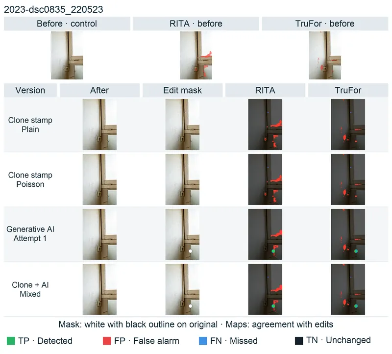](boards/2023-dsc0835_220523--compact-hd.webp)

[High resolution](boards/2023-dsc0835_220523--compact-hd.webp) · [Detailed trials and enlargements](gallery/README.md#2023-dsc0835_220523)

### 2022-dsc0663_260522 · 5 variants

[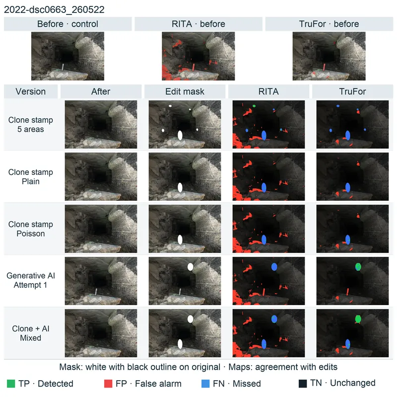](boards/2022-dsc0663_260522--compact-hd.webp)

[High resolution](boards/2022-dsc0663_260522--compact-hd.webp) · [Detailed trials and enlargements](gallery/README.md#2022-dsc0663_260522)

### 2022-dsc7644_310822 · 2 variants

[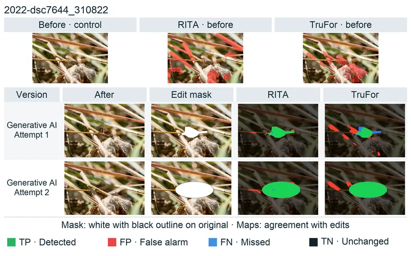](boards/2022-dsc7644_310822--compact-hd.webp)

[High resolution](boards/2022-dsc7644_310822--compact-hd.webp) · [Detailed trials and enlargements](gallery/README.md#2022-dsc7644_310822)

Other comparison boards · 23 sources

### 2022-dsc0666_260522 · 3 variants

[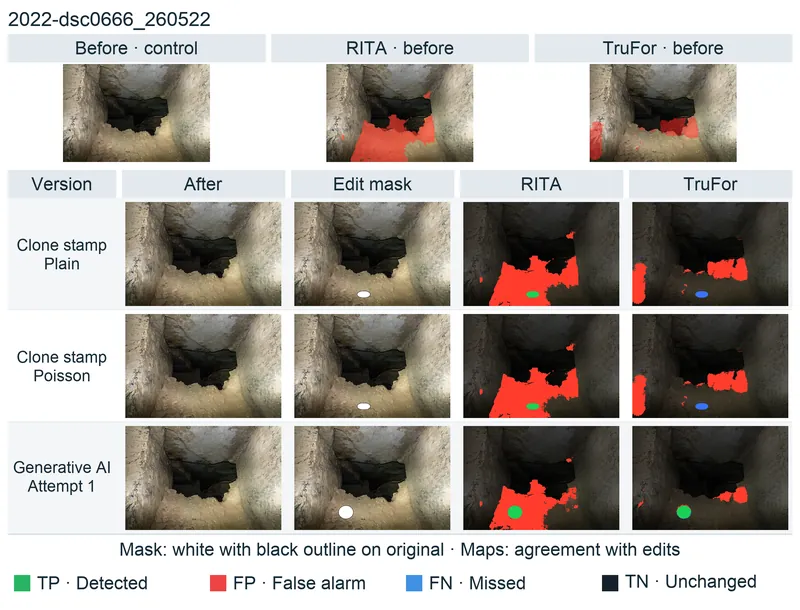](boards/2022-dsc0666_260522--compact-hd.webp)

[High resolution](boards/2022-dsc0666_260522--compact-hd.webp) · [Detailed trials and enlargements](gallery/README.md#2022-dsc0666_260522)

### 2022-dsc0702_260522 · 4 variants

[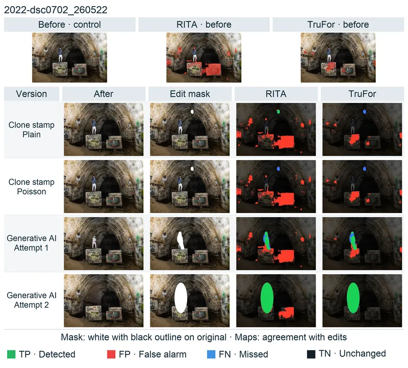](boards/2022-dsc0702_260522--compact-hd.webp)

[High resolution](boards/2022-dsc0702_260522--compact-hd.webp) · [Detailed trials and enlargements](gallery/README.md#2022-dsc0702_260522)

### 2022-dsc0713_260522 · 4 variants

[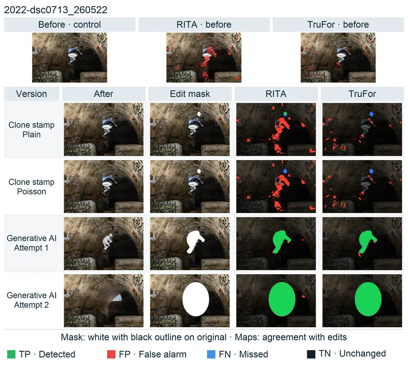](boards/2022-dsc0713_260522--compact-hd.webp)

[High resolution](boards/2022-dsc0713_260522--compact-hd.webp) · [Detailed trials and enlargements](gallery/README.md#2022-dsc0713_260522)

### 2022-dsc0727_260522 · 6 variants

[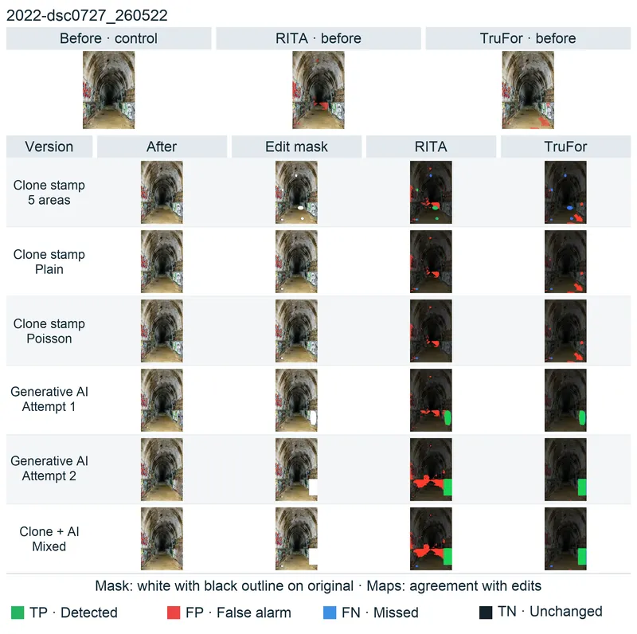](boards/2022-dsc0727_260522--compact-hd.webp)

[High resolution](boards/2022-dsc0727_260522--compact-hd.webp) · [Detailed trials and enlargements](gallery/README.md#2022-dsc0727_260522)

### 2022-dsc0867_260522 · 5 variants

[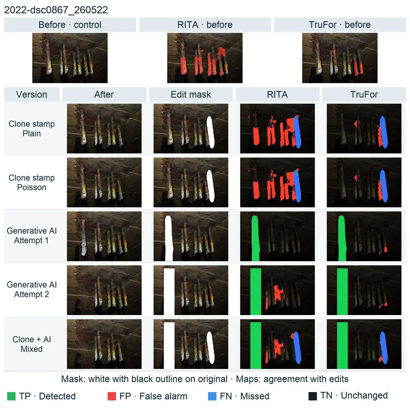](boards/2022-dsc0867_260522--compact-hd.webp)

[High resolution](boards/2022-dsc0867_260522--compact-hd.webp) · [Detailed trials and enlargements](gallery/README.md#2022-dsc0867_260522)

### 2022-dsc0873_260522 · 5 variants

[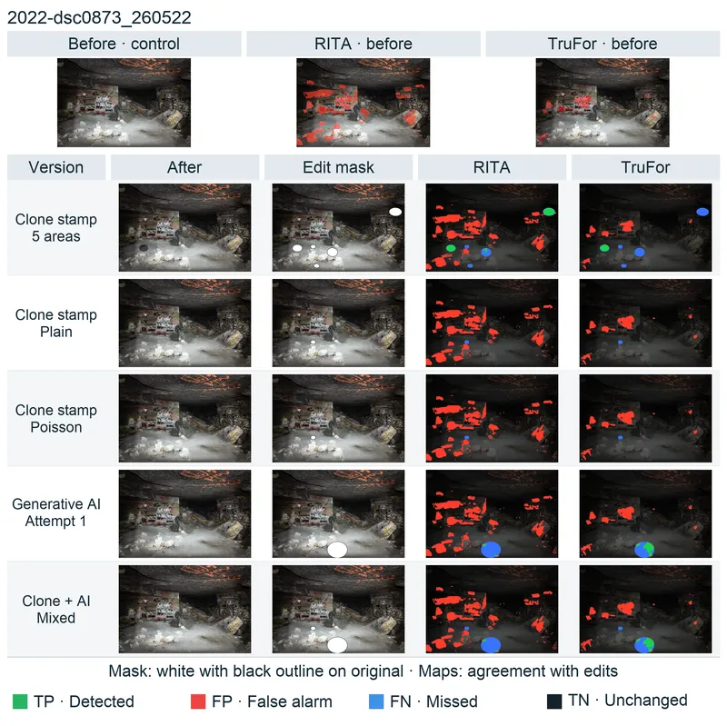](boards/2022-dsc0873_260522--compact-hd.webp)

[High resolution](boards/2022-dsc0873_260522--compact-hd.webp) · [Detailed trials and enlargements](gallery/README.md#2022-dsc0873_260522)

### 2022-dsc0880_260522 · 4 variants

[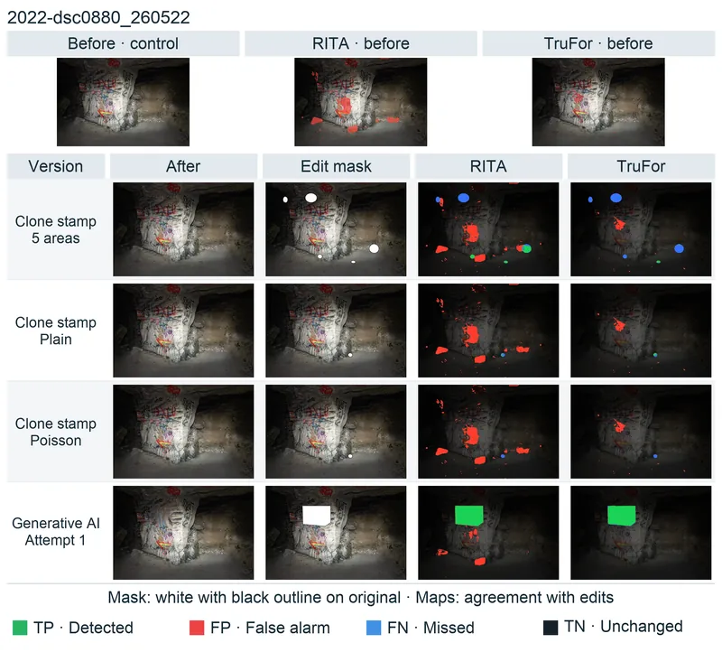](boards/2022-dsc0880_260522--compact-hd.webp)

[High resolution](boards/2022-dsc0880_260522--compact-hd.webp) · [Detailed trials and enlargements](gallery/README.md#2022-dsc0880_260522)

### 2022-dsc0884_260522 · 5 variants

[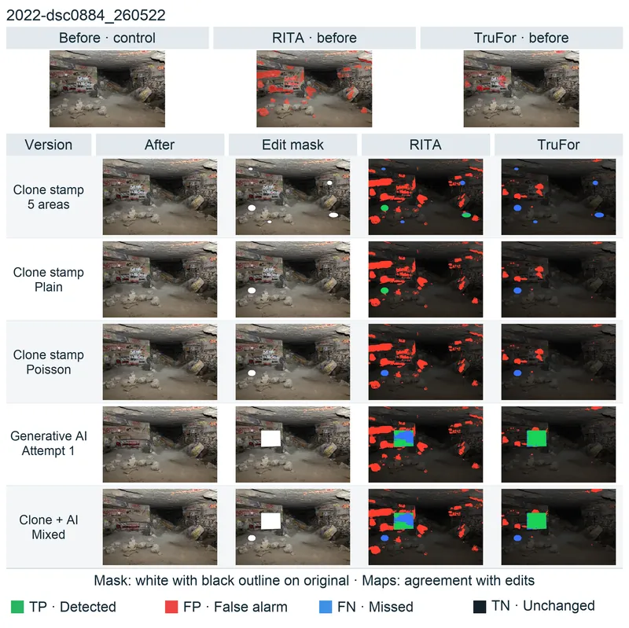](boards/2022-dsc0884_260522--compact-hd.webp)

[High resolution](boards/2022-dsc0884_260522--compact-hd.webp) · [Detailed trials and enlargements](gallery/README.md#2022-dsc0884_260522)

### 2022-dsc0890_260522 · 5 variants

[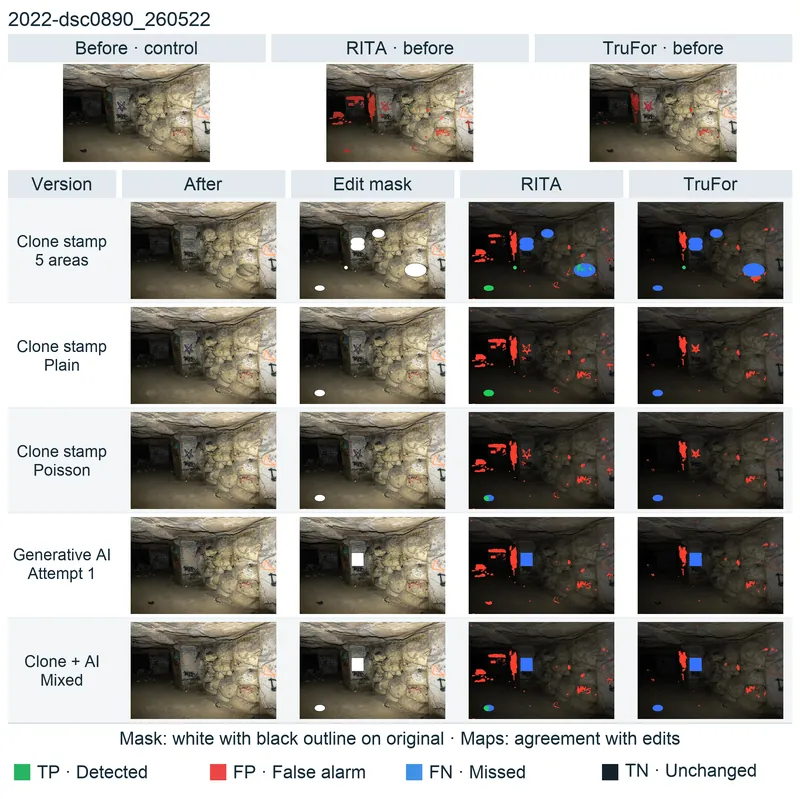](boards/2022-dsc0890_260522--compact-hd.webp)

[High resolution](boards/2022-dsc0890_260522--compact-hd.webp) · [Detailed trials and enlargements](gallery/README.md#2022-dsc0890_260522)

### 2022-dsc0896_260522 · 4 variants

[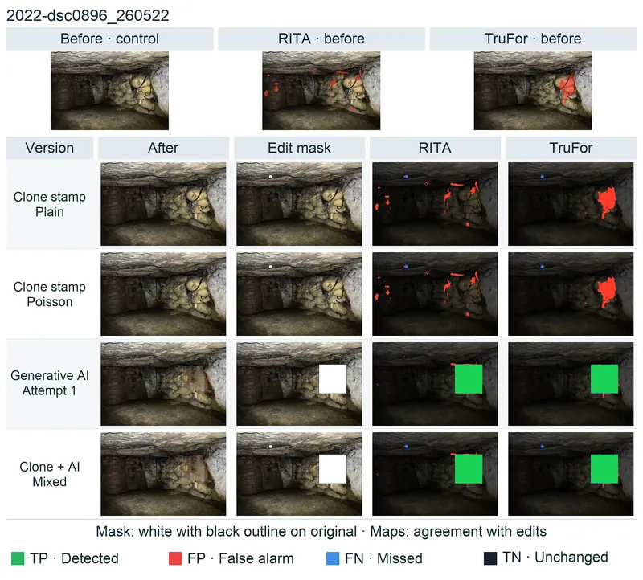](boards/2022-dsc0896_260522--compact-hd.webp)

[High resolution](boards/2022-dsc0896_260522--compact-hd.webp) · [Detailed trials and enlargements](gallery/README.md#2022-dsc0896_260522)

### 2022-dsc0902_260522 · 5 variants

[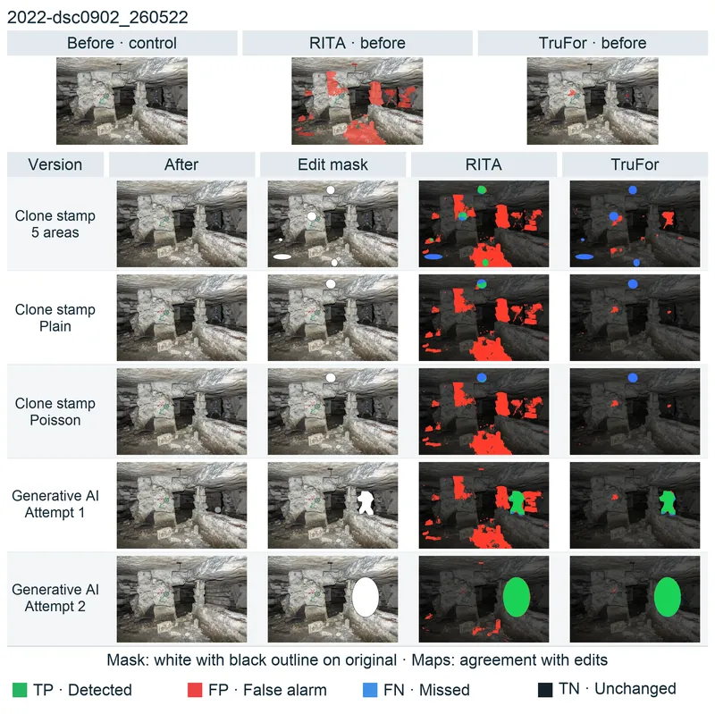](boards/2022-dsc0902_260522--compact-hd.webp)

[High resolution](boards/2022-dsc0902_260522--compact-hd.webp) · [Detailed trials and enlargements](gallery/README.md#2022-dsc0902_260522)

### 2022-dsc7622_310822 · 4 variants

[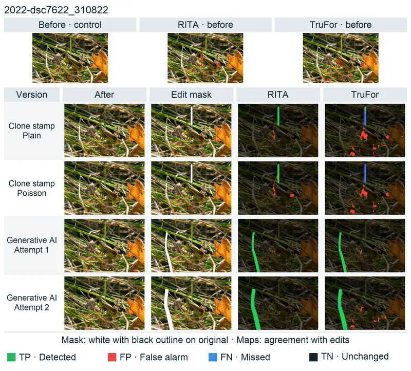](boards/2022-dsc7622_310822--compact-hd.webp)

[High resolution](boards/2022-dsc7622_310822--compact-hd.webp) · [Detailed trials and enlargements](gallery/README.md#2022-dsc7622_310822)

### 2022-dsc7634_310822 · 2 variants

[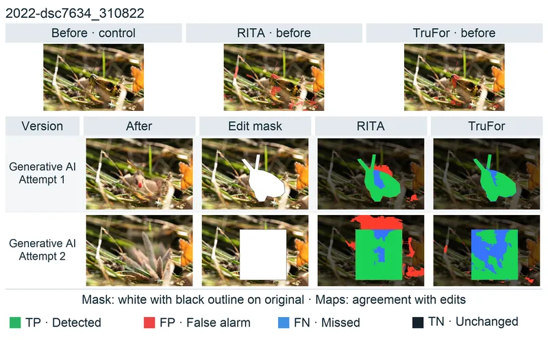](boards/2022-dsc7634_310822--compact-hd.webp)

[High resolution](boards/2022-dsc7634_310822--compact-hd.webp) · [Detailed trials and enlargements](gallery/README.md#2022-dsc7634_310822)

### 2022-dsc7637_310822 · 2 variants

[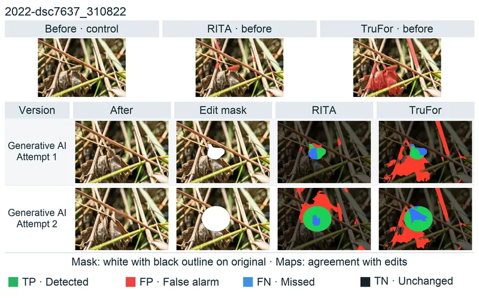](boards/2022-dsc7637_310822--compact-hd.webp)

[High resolution](boards/2022-dsc7637_310822--compact-hd.webp) · [Detailed trials and enlargements](gallery/README.md#2022-dsc7637_310822)

### 2022-dsc7647_310822 · 4 variants

[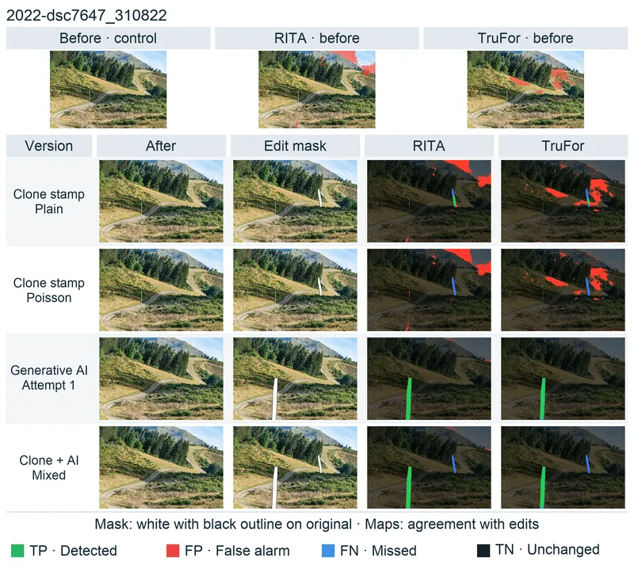](boards/2022-dsc7647_310822--compact-hd.webp)

[High resolution](boards/2022-dsc7647_310822--compact-hd.webp) · [Detailed trials and enlargements](gallery/README.md#2022-dsc7647_310822)

### 2022-dsc7653_310822 · 3 variants

[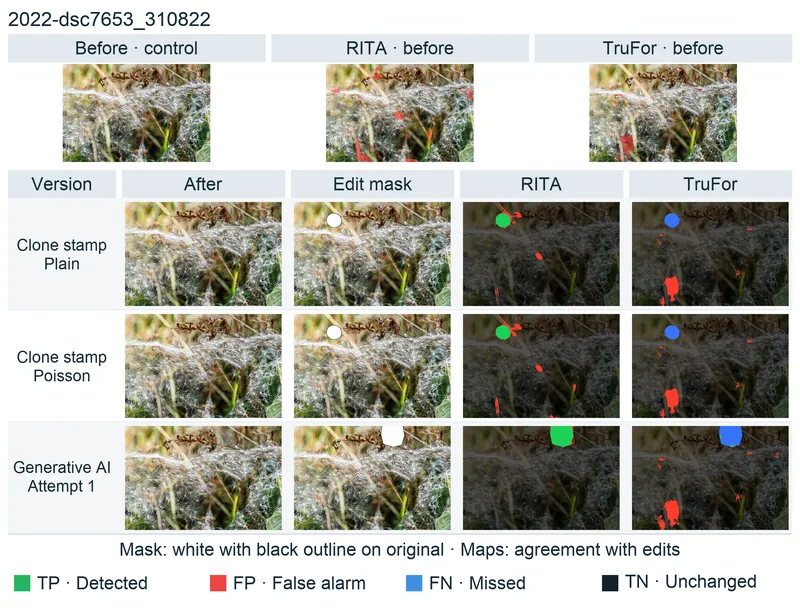](boards/2022-dsc7653_310822--compact-hd.webp)

[High resolution](boards/2022-dsc7653_310822--compact-hd.webp) · [Detailed trials and enlargements](gallery/README.md#2022-dsc7653_310822)

### 2023-dsc0016_030223-hd-low_res-width-6000px · 4 variants

[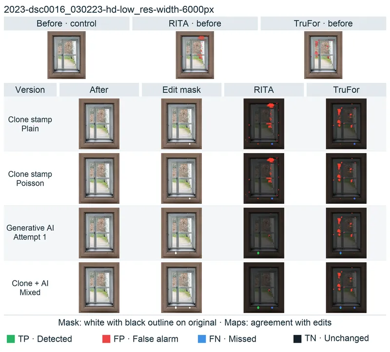](boards/2023-dsc0016_030223-hd-low_res-width-6000px--compact-hd.webp)

[High resolution](boards/2023-dsc0016_030223-hd-low_res-width-6000px--compact-hd.webp) · [Detailed trials and enlargements](gallery/README.md#2023-dsc0016_030223-hd-low_res-width-6000px)

### 2023-dsc0229_260223 · 1 variants

[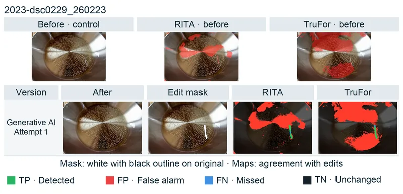](boards/2023-dsc0229_260223--compact-hd.webp)

[High resolution](boards/2023-dsc0229_260223--compact-hd.webp) · [Detailed trials and enlargements](gallery/README.md#2023-dsc0229_260223)

### 2023-dsc0232_260223 · 4 variants

[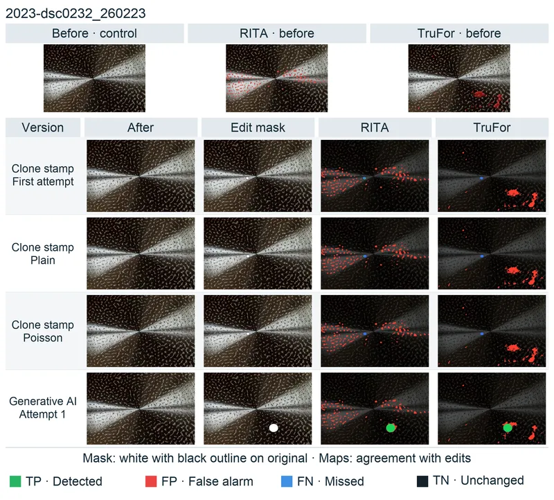](boards/2023-dsc0232_260223--compact-hd.webp)

[High resolution](boards/2023-dsc0232_260223--compact-hd.webp) · [Detailed trials and enlargements](gallery/README.md#2023-dsc0232_260223)

### 2023-dsc0256_260223 · 4 variants

[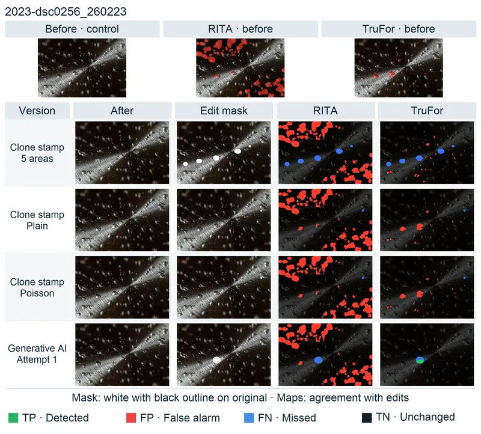](boards/2023-dsc0256_260223--compact-hd.webp)

[High resolution](boards/2023-dsc0256_260223--compact-hd.webp) · [Detailed trials and enlargements](gallery/README.md#2023-dsc0256_260223)

### 2023-dsc0277_260223 · 3 variants

[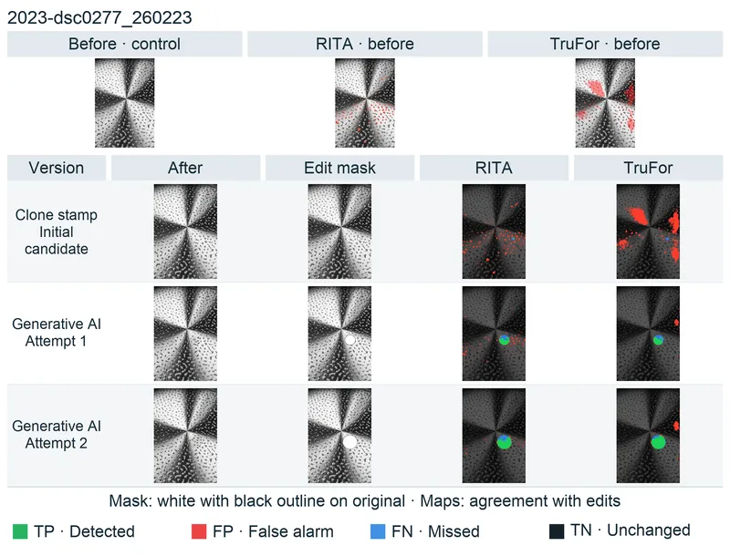](boards/2023-dsc0277_260223--compact-hd.webp)

[High resolution](boards/2023-dsc0277_260223--compact-hd.webp) · [Detailed trials and enlargements](gallery/README.md#2023-dsc0277_260223)

### 2023-dsc0453_260223 · 2 variants

[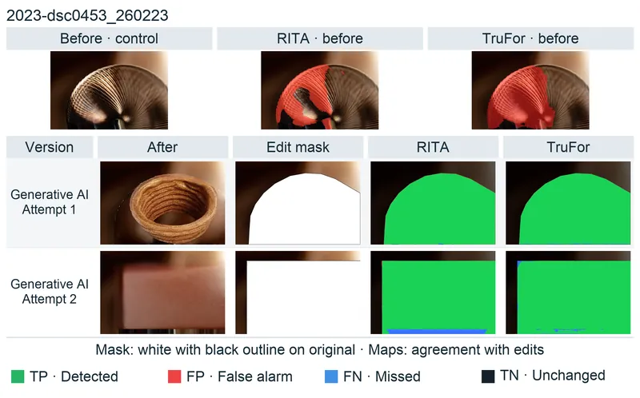](boards/2023-dsc0453_260223--compact-hd.webp)

[High resolution](boards/2023-dsc0453_260223--compact-hd.webp) · [Detailed trials and enlargements](gallery/README.md#2023-dsc0453_260223)

### preliminary-dsc3921 · 2 variants

[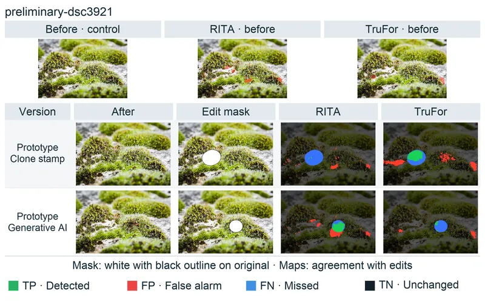](boards/preliminary-dsc3921--compact-hd.webp)

[High resolution](boards/preliminary-dsc3921--compact-hd.webp) · [Detailed trials and enlargements](gallery/README.md#preliminary-dsc3921)

Appendix · averages and before/after comparison

The main tables calculate one score from the pooled areas of all versions. Here, the mean per version first calculates a score for each version, then averages those scores. The mean per source photograph first averages the versions of each photograph, then averages the photographs: a photograph with many variants therefore carries no extra weight. These calculations answer different questions and can produce different figures without contradiction.

The before/after comparison examines only the locations of the known edits, first in the image before intervention and then in the edited image. Each percentage uses only that area as its denominator. It therefore does not describe the flagged area across the whole control images. After intervention, the retained flags and new flags make up the total detected; some flags present before may disappear. Rounded sums may differ by 0.01 percentage points.

### Clone stamp and Poisson blending · 49 versions

**Other ways of averaging the scores**

| Question or measure | RITA | TruFor |
| --- | ---: | ---: |
| Mean of the scores for each version · F1 | 9.96% | 2.35% |
| Mean of the scores for each version · IoU | 6.77% | 1.36% |
| Mean giving equal weight to each source photograph · F1 | 10.36% | 3.43% |
| Mean giving equal weight to each source photograph · IoU | 7.19% | 2.08% |

**Changes in flags at the same locations**

| Question or measure | RITA | TruFor |
| --- | ---: | ---: |
| Within the future edited area: area flagged before intervention | 21.90% | 9.96% |
| Within the edited area: area flagged both before and after intervention | 8.86% | 0.20% |
| Within the edited area: area flagged after intervention, but not before | 22.06% | 5.86% |
| Within the edited area: total area flagged after intervention | 30.92% | 6.06% |

### Generative AI · 37 versions

**Other ways of averaging the scores**

| Question or measure | RITA | TruFor |
| --- | ---: | ---: |
| Mean of the scores for each version · F1 | 63.10% | 67.98% |
| Mean of the scores for each version · IoU | 55.08% | 60.30% |
| Mean giving equal weight to each source photograph · F1 | 56.61% | 61.53% |
| Mean giving equal weight to each source photograph · IoU | 49.02% | 53.71% |

**Changes in flags at the same locations**

| Question or measure | RITA | TruFor |
| --- | ---: | ---: |
| Within the future edited area: area flagged before intervention | 19.82% | 27.58% |
| Within the edited area: area flagged both before and after intervention | 18.87% | 26.63% |
| Within the edited area: area flagged after intervention, but not before | 74.55% | 64.15% |
| Within the edited area: total area flagged after intervention | 93.41% | 90.78% |

### Clone stamp + generative AI · 10 versions

**Other ways of averaging the scores**

| Question or measure | RITA | TruFor |
| --- | ---: | ---: |
| Mean of the scores for each version · F1 | 43.18% | 55.55% |
| Mean of the scores for each version · IoU | 34.26% | 46.77% |
| Mean giving equal weight to each source photograph · F1 | 43.18% | 55.55% |
| Mean giving equal weight to each source photograph · IoU | 34.26% | 46.77% |

**Changes in flags at the same locations**

| Question or measure | RITA | TruFor |
| --- | ---: | ---: |
| Within the future edited area: area flagged before intervention | 14.49% | 12.79% |
| Within the edited area: area flagged both before and after intervention | 8.45% | 9.67% |
| Within the edited area: area flagged after intervention, but not before | 61.73% | 65.76% |
| Within the edited area: total area flagged after intervention | 70.18% | 75.43% |

Several versions share the same source. These results describe the localisation of the added edits, rather than a rate of correctly classified authentic or forged images. Original methods: [TruFor](https://github.com/grip-unina/TruFor) ([CVPR 2023](https://openaccess.thecvf.com/content/CVPR2023/papers/Guillaro_TruFor_Leveraging_All-Round_Clues_for_Trustworthy_Image_Forgery_Detection_and_CVPR_2023_paper.pdf)) and [RITA](https://github.com/scu-zjz/RITA) ([paper](https://arxiv.org/abs/2509.20006)).
