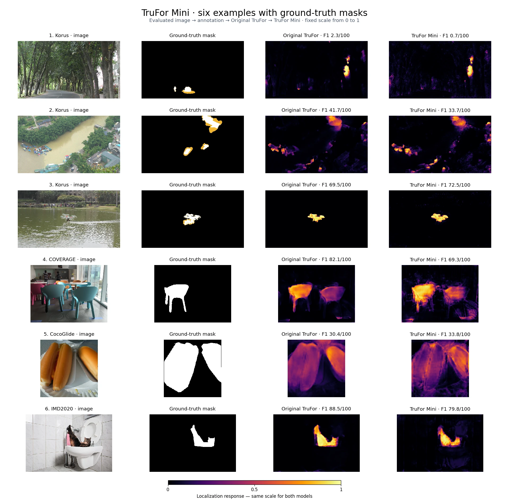
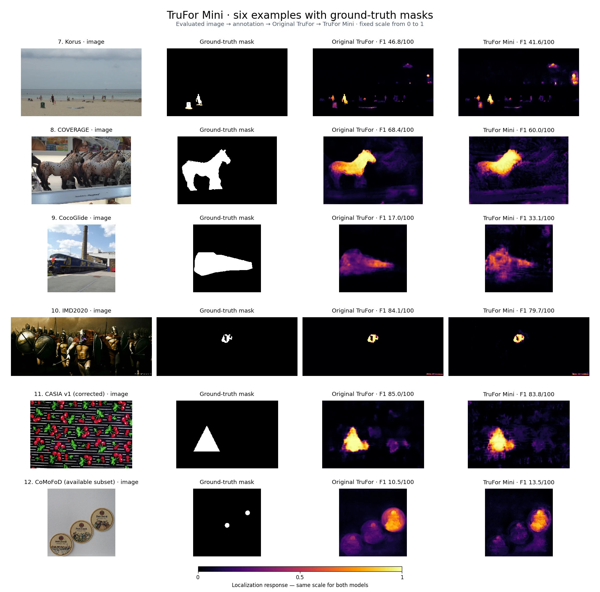

# TruFor and TruFor Mini — study and supplementary files

[← SHERLOQ Web](../../../README.md#examples-from-the-web-engine)

[Read the complete study](TRUFOR-MINI-STUDY-EN.pdf) · [Read the manuscript](TRUFOR-MINI-STUDY-EN.md) · [Reproduction code and frozen model recipe](reproduction/README.md).

[Browser execution measurements](../../../docs/TRUFOR-MINI-VALIDATION.md).

## Comparison examples

The same evaluated image, known edit mask, original TruFor and TruFor Mini are shown in each row, using a common response scale from 0 to 1.

## Supplementary results

- [Image classification](image-classification.csv) · [Pixel localization](pixel-localisation.csv)
- [Per-image pixel averages](pixel-macro.csv) · [Pixel ranking](pixel-ranking.csv) · [Category recall](category-recall.csv)
- [Paired timings](timings.csv) · [Map agreement](direct-agreement.csv)
- [Intervals by collection](bootstrap.json) · [Annotation conventions](conventions-secondaires.csv)
- [Individual measurements](mesures-par-image.csv) · [Aggregate results](resultats-agreges.json)
- [Additional annotation analysis](analyse-secondaire.json) · [Exploratory image thresholds](image-thresholds-exploratory.csv)
- [Recompute the supplementary tables](REPRODUCTION-EN.txt) · [Recomputation script](reproduire.py)
- [Channel 333 protocol](REPRODUCE-333-EN.md) · [Extraction script](extract_channel333.py)

The reproduction directory preserves the original TruFor and CMX notices. Dataset names and annotations remain attributed to their respective sources in the study and case manifest.
