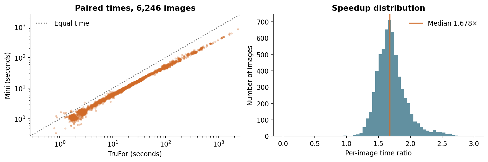
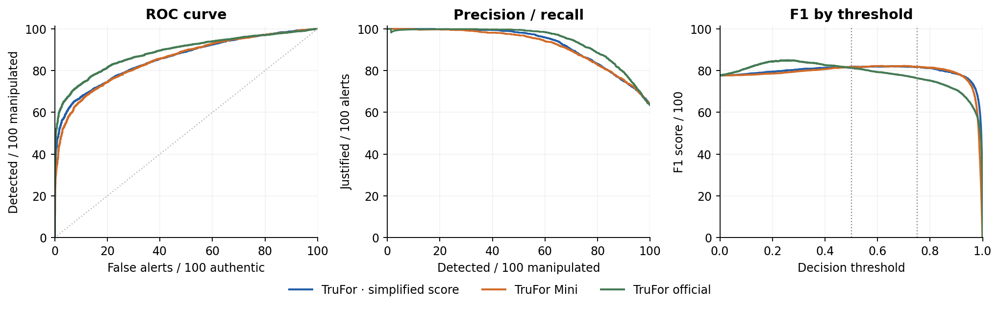
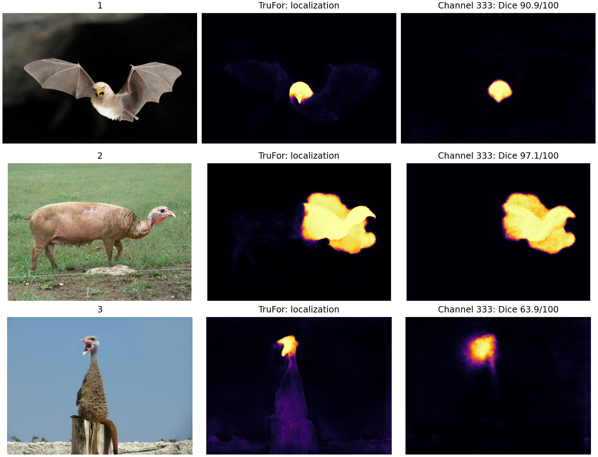

# TruFor and TruFor Mini

**Detection, localization and computation time across seven collections**  
Paired comparative study - 3 November 2026.

## Abstract

This study measures how reducing TruFor changes inference speed and manipulation detection. TruFor Mini retains the Transformer blocks, reduces the channels in the noise branch and the localization units, and uses approximate attention in the noise branch.

The two frozen models processed the same **6,246 images from seven collections**: 2,279 authentic and 3,967 manipulated. Computation uses FP32 at native resolution, without resizing or recompression. We distinguish the official TruFor detector from a simplified score shared by both networks, computed from the strongest 1% of pixel responses. Evaluation covers true and false positives and negatives, F1, AUROC and inference times. Localization is compared with annotations on 5,874 images. Thresholds of 0, 0.5 and 0.75 are examined; uncertainty intervals use 2,000 paired bootstrap resamples, keeping related images together and stratifying by collection.

The ratio of summed inference times reaches **2.06×**, a **51.4% time reduction**. At threshold 0.5, using the shared score, classification F1 changes from **81.8 to 81.7/100**, while AUROC changes from 85.7 to 85.2/100. Macro localization F1 changes from **63.3 to 61.5/100**. The acceleration therefore comes with a measurable loss, more apparent in localization than in classification F1. Known overlap with training and development limits the generalization of these results to new sources.

## Conclusion

The value of Mini depends on the intended diagnostic task: flagging an image for examination and precisely delineating its manipulation call for different trade-offs. Similar classification F1 therefore does not make the two models interchangeable. Likewise, a higher overall number of correct decisions can result from preserving intact pixels, which form a large majority, despite missing more manipulations. The study places the computational gain in relation to these uses and makes explicit what each metric favors.

## 1. Detecting manipulated images

| Name in this study | How the whole-image decision is computed |
| --- | --- |
| TruFor official | Full network and the learned detector provided by the authors. |
| TruFor - simplified score | Same full network; score = mean of the strongest 1% of pixel responses. |
| TruFor Mini | Reduced network with the same simplified score; the official detection head is not retained. |

These are two models with three decision rules. The simplified score provides a common comparison; it is not a calibrated probability of image integrity. At threshold 0.5:

| What the percentage means | TruFor official | TruFor - simplified score | TruFor Mini |
| --- | --- | --- | --- |
| Among manipulated images, those correctly detected | 71.5% | 91.1% | 92.9% |
| Among authentic images, those wrongly flagged | 7.8% | 54.9% | 60.0% |
| Among flagged images, those actually manipulated | 94.1% | 74.3% | 72.9% |
| Across all images, correct decisions | 79.0% | 74.3% | 73.6% |

Each row refers to a different population. Missed manipulations and correctly preserved authentic images complement the first two rows to 100. Mini detects more manipulated images with the simplified score, at the cost of more false alerts; the official decision is more conservative about flagging authentic images.

| Rule | F1 / 100 | AUROC / 100 | Balanced accuracy / 100 |
| --- | --- | --- | --- |
| TruFor official | 81.2 | 88.8 | 81.8 |
| TruFor - simplified score | 81.8 | 85.7 | 68.1 |
| TruFor Mini | 81.7 | 85.2 | 66.5 |

F1 combines the proportion of manipulations detected with the proportion of justified alerts; **81.7/100 does not mean 81.7% correct decisions**. AUROC measures ranking across all thresholds (50 = random, 100 = perfect separation). Balanced accuracy gives equal weight to the two classes.

## 2. Localizing manipulations

The binary evaluation covers 5,874 images: 3,778 manipulated and 2,096 authentic. Responses are compared with native-resolution masks, without excluding boundaries or inverting predictions. Unmanipulated pixels also include the intact backgrounds of manipulated images. At threshold 0.5:

| What the percentage means | TruFor | TruFor Mini |
| --- | --- | --- |
| Among manipulated pixels, those correctly detected | 69.8% | 65.5% |
| Among unmanipulated pixels, those wrongly flagged | 4.6% | 3.7% |
| Among flagged pixels, those actually manipulated | 43.1% | 47.1% |
| Across all evaluated pixels, correct decisions | 94.2% | 94.9% |

**Intact pixels are about twenty times more numerous.** The false alerts Mini avoids in this population outweigh, in the total, its lost detections of manipulated pixels. Giving equal weight to both classes yields balanced accuracy of **82.6/100 for TruFor and 80.9/100 for Mini**. Always predicting “unmanipulated” would even give 95.3% correct decisions while missing every manipulation: only 4.7% of pixels are positive.

## Two ways to weight localization

**Micro** F1 pools all pixels, giving more weight to large images. **Macro** F1 gives equal weight to each annotated manipulated image; authentic images are tracked separately.

| Weighting | Threshold | TruFor F1 / 100 | Mini F1 / 100 |
| --- | --- | --- | --- |
| All pixels (micro) | 0.50 | 53.3 | 54.8 |
| All pixels (micro) | 0.75 | 57.8 | 56.1 |
| Each manipulated image (macro) | 0.50 | 63.3 | 61.5 |
| Each manipulated image (macro) | 0.75 | 58.7 | 56.2 |

Mini’s micro gain at 0.5 disappears at 0.75. The macro decrease at both thresholds indicates an average localization loss per manipulated image that image-classification F1 does not reveal.

## Similarity between the two outputs

The absolute difference in responses, averaged over images, is **4.08 points** on a scale of 100. The mean per-image Dice of positive regions is **69.0/100** at 0.5, excluding the 249 pairs in which both maps are empty. This similarity compares the models with each other; correctness is assessed separately against the annotations.

## 3. Results by collection and speed

At threshold 0.5, arrows run from **TruFor - simplified score to Mini**. F1 and AUROC are on a scale of 100; false alerts are per 100 authentic images. Localization is macro F1 over valid manipulated images. Counts are shown as authentic / manipulated.

| Collection | Images auth. / manip. | Image F1 | Image AUROC | Authentic images wrongly flagged (%) | Localization F1 | Speedup |
| --- | --- | --- | --- | --- | --- | --- |
| Corrected CASIA | 800 / 920 | 79.0 → 78.8 | 88.5 → 88.6 | 42.9 → 44.4 | 68.7 → 65.5 | 1.58× |
| CocoGlide | 512 / 512 | 69.3 → 70.3 | 74.1 → 75.0 | 39.3 → 49.6 | 36.2 → 37.7 | 1.58× |
| Columbia | 183 / 180 | 72.9 → 71.9 | 99.1 → 96.8 | 73.2 → 77.0 | — | 1.78× |
| CoMoFoD subset | 50 / 25 | 43.5 → 46.8 | 54.9 → 55.4 | 58.0 → 68.0 | 20.9 → 20.0 | 1.66× |
| COVERAGE | 100 / 100 | 71.3 → 69.1 | 76.1 → 76.6 | 59.0 → 76.0 | 55.6 → 55.6 | 1.59× |
| IMD2020 | 414 / 2010 | 89.9 → 90.0 | 84.7 → 82.4 | 94.2 → 94.9 | 71.3 → 69.0 | 2.13× |
| Korus | 220 / 220 | 69.3 → 71.3 | 75.6 → 74.7 | 43.2 → 51.8 | 38.1 → 38.1 | 1.98× |

Overall scores depend on collection sizes and composition. IMD2020 illustrates the limitation of F1 alone: it remains high although almost all authentic images are flagged by the simplified score. CoMoFoD covers only the available subset, not its full library.

## Inference time

Mean times are **35.22 s/image for TruFor and 17.11 s/image for Mini**. The ratio of summed times is 2.06×, or 51.4% less time; the median individual speedup is 1.68×. Mini is faster in 6,234 cases.



Times for both models on each image. The diagonal indicates equality; the distribution shows the spread of speedups.

Timers include computation and retrieval of the output, excluding weight loading and disk input/output. Images were processed concurrently, in the order TruFor then Mini, with one pass per model. The sums are therefore not wall-clock durations of separate batches. Speed intervals describe the mix of images rather than repeated batches; no energy, memory or GPU gain is measured.

## 4. Effect of the decision threshold

Thresholds **0, 0.5 and 0.75** were fixed before the batch; a decision is positive when the score is greater than or equal to the threshold. Results at 0.5 appear in Section 1. At 0.75:

| Rule | Detected / 100 manipulated | Missed / 100 manipulated | Wrongly flagged / 100 authentic | Preserved / 100 authentic | F1 / 100 |
| --- | --- | --- | --- | --- | --- |
| TruFor official | 62.7 | 37.3 | 2.6 | 97.4 | 76.4 |
| TruFor - simplified score | 80.9 | 19.1 | 29.5 | 70.5 | 81.8 |
| TruFor Mini | 82.8 | 17.2 | 34.1 | 65.9 | 81.8 |

Raising the threshold reduces false alerts and misses more manipulations. For Mini, F1 remains nearly unchanged between the two thresholds despite this shift in errors. At zero, all images are positive: recall is 100%, no authentic image is preserved, yet F1 reaches 77.7/100 on this imbalanced corpus.



Exact image-level curves. The third plot varies the threshold on its horizontal axis; the other two show ranking trade-offs.

Thresholds identified after examining these curves remain exploratory. A threshold chosen after inspecting these curves would require a separate evaluation before being presented as a validated setting.

## 5. Uncertainty and sensitivity checks

The 95% intervals use 2,000 paired bootstrap resamples, stratified by collection. Sampling acts on 3,363 components linking declared source groups or shared SHA256 hashes; images in the same component stay together. Both models share the same resampling weights. Undocumented donor dependencies remain incompletely represented.

| Measure (F1 at threshold 0.5) | Estimate | 95% interval |
| --- | --- | --- |
| Ratio of summed times | 2.06× | [2.01, 2.10]× |
| Image AUROC difference | -0.53 points | [-0.82, -0.25] points |
| Image F1 difference | -0.10 points | [-0.50, 0.31] points |
| Macro localization F1 difference | -1.77 points | [-2.04, -1.50] points |
| Micro localization F1 difference | +1.49 points | [0.15, 2.79] points |

Differences are Mini minus TruFor, in score points out of 100, using the simplified score for classification. They quantify the closeness of image F1 while indicating lower AUROC and macro localization F1 on the complete corpus. Intervals are reported measure by measure, without a multiple-testing procedure.

| Check | Images | Speedup | Image F1: TruFor → Mini / 100 | Macro localization F1: TruFor → Mini / 100 |
| --- | --- | --- | --- | --- |
| Without duplicates | 6229 | 2.06× | 81.91 → 81.82 | 63.26 → 61.49 |
| Without IMD2020 | 3822 | 1.89× | 73.91 → 73.96 | 54.13 → 52.89 |
| Without images marked as previously examined | 5990 | 2.06× | 82.26 → 82.19 | 63.99 → 62.18 |

These checks confirm several findings: shorter computation, similar classification F1 and lower macro localization F1. Not all measures are stable: without IMD2020, AUROC becomes 81.97 → 82.07/100, with a difference interval including zero; the micro localization gain also disappears.

The comparison thus characterizes a reproducible trade-off on these collections. Known overlap with TruFor training and images examined during development limits generalization to new sources. It does not erase the measured differences, but removing those images does not reconstruct a complete donor separation. The study measures the Mini checkpoint as a whole, without causally isolating each reduction’s contribution.

## 6. Method and annotations

## Reduced model

The **flow-inactive** checkpoint, called TruFor Mini here, retains all Transformer blocks and the original spatial stride. It uses eight localization units with an affine readout, 17 Noiseprint++ convolutions and 184 intermediate channels removed in total, without MLP pruning. Its RGB branch retains exact attention; the noise branch averages queries in spatial groups at the first two stages, then uses global context at the next two. This approximate attention is part of the evaluated reduction.

Full TruFor retains its original weights, architecture and heads. Its attention-query chunking retains all global keys. Both models run in FP32; RGB images are divided by 256, without resizing or recompression. The Mini file stored in mixed precision is converted to FP32: its disk size alone does not measure the reduction in computation or parameters.

## Corpus and mask conventions

The manifest contains **6,229 distinct contents**: 17 additional occurrences are duplicates within CoMoFoD and IMD2020, with no class conflict or duplicate across collections. Counts by collection appear in Section 3. The CASIA image with a missing mask was excluded before computation. Nine COVERAGE masks have incompatible dimensions: their images remain in classification, with the raw annotation retained, but are excluded from localization.

| Annotation | Interpretation used |
| --- | --- |
| Korus | White and gray positive; black negative; other values ignored. A variant ignores gray. |
| Columbia | Camera provenance and boundaries: included in classification, with spatial diagnostics kept separate from the primary binary result. |
| Other binary masks | Provided mask ≥ 128; matching native dimensions. No annotation resizing. |

| Convention, threshold 0.5 | Micro F1 / 100: TruFor → Mini | Detected / 100 manipulated pixels: TruFor → Mini |
| --- | --- | --- |
| Korus: white and gray positive | 37.2 → 35.3 | 32.5 → 31.7 |
| Korus: gray ignored | 49.2 → 47.3 | 41.6 → 39.9 |

Manifest categories combine operation type and collection: copy-move, generative inpainting, splicing, manual composites and Internet manipulations. The 512 generative cases come from CocoGlide and the 2,010 Internet manipulations from IMD2020, documented in the original TruFor training data. Category results therefore cannot isolate the effect of the manipulation technique alone.

## Data-preservation checks

The hashes of all 6,246 map archives, 6,246 histograms and 10,213 indexed source files were verified. An independent check on 28 cases reproduced scores and counts at all three thresholds; 114 cross-checks validated the aggregates. Saved outputs were used to examine thresholds without rerunning the networks.

## 7. Comparison with the TruFor publication

Tables 1 and 2 of Guillaro et al. [1] provide two distinct comparisons. For classification, we use the official decision. Each cell below gives **AUROC; balanced accuracy at 0.5**, on a scale of 100.

| Collection | Publication: AUROC; BA | Our TruFor official: AUROC; BA |
| --- | --- | --- |
| Corrected CASIA / CASIAv1+ | 91.6 ; 81.3 | 90.6 ; 82.0 |
| COVERAGE | 77.0 ; 68.0 | 76.8 ; 69.0 |
| Columbia | 99.6 ; 98.4 | 99.6 ; 98.6 |
| CocoGlide | 75.2 ; 63.9 | 75.3 ; 64.4 |

Values for Columbia, COVERAGE and CocoGlide are close to the published results. Corrected CASIA differs from CASIAv1+: the latter replaces authentic images with COREL images to reduce overlap with training data.

## Localization: a different protocol

The official code [2] excludes boundaries with filters of sizes 15/11, uses the strict rule > 0.5 and selects the better polarity per image using the annotation. We applied this secondary analysis to the retained outputs. Regions with no positive pixels after erosion and Columbia are excluded; Korus gray follows our convention. Counts therefore differ from the published benchmark. The published “best threshold” is an optimum per image that also uses ground truth, not a deployable setting.

| Collection | Published F1 fixed; best / 100 | Secondary at 0.5: TruFor → Mini / 100 | Manipulated images in secondary analysis |
| --- | --- | --- | --- |
| Corrected CASIA | 73.7 ; 82.2 | 74.3 → 72.4 | 900 |
| CocoGlide | 52.3 ; 72.0 | 52.6 → 52.9 | 508 |
| Columbia | 85.9 ; 91.4 | — | — |
| CoMoFoD subset | — | 23.9 → 23.1 | 25 |
| COVERAGE | 60.0 ; 73.5 | 62.6 → 61.7 | 90 |
| IMD2020 | — | 73.2 → 71.6 | 1977 |
| Korus | — | 43.2 → 42.9 | 220 |

These macro scores, with boundaries excluded and polarity selected, are not directly comparable with primary micro F1. The secondary comparison follows the conventions and exclusions stated above.

## 8. Channel 333: reading a decision from a channel

Before building Mini, we observed TruFor activations at different depths: 25 sets of representations, totaling 4,352 dimensions. We investigated which channels could recover the model’s localization output through a simple readout. On 52 images used for development, with cross-validation separating sources, **channel 333 was selected first in each of the three folds**.

### Where to find it

In the original checkpoint studied, `model.decode_head.linear_fuse` combines representations from the four scales through a 1×1 convolution, BatchNorm and ReLU. Its output is a tensor `[B, 512, h, w]`: B images, 512 channels and a spatial grid h×w. **333 is the channel index in this tensor**, counted from zero; it therefore identifies the 334th channel.

### How to obtain its exact response

1. Load the original full model (`mit_b2`, `MLPDecoder`, 512 decoder channels) using `trufor.yaml`, without loading additional pretrained weights. Load `checkpoint['state_dict']` with `strict=True`, then set FP32 and evaluation mode. The checkpoint SHA256 appears in the Appendix. The code below assumes this model and the input `x` prepared in step 2.

2. Open the original image, apply its EXIF orientation, convert it to RGB, then construct a tensor `[1, 3, H, W]` divided by **256**. Keep its dimensions; ImageNet normalization is applied inside the model.

3. Register a hook on **`model.decode_head.linear_fuse`**, the localization decoder’s fusion block. On every call, retain `output[:, 333:334, :, :]`, the activation **after ReLU**. If the engine processes bands of rows, concatenate all captured tensors along the height dimension, in order.

4. Interpolate this activation to the native dimensions `(H, W)`, using bilinear interpolation with `align_corners=False`, then apply:

```python
parts = []
def capture(_module, _inputs, output):
    parts.append(output[:, 333:334].detach().clone())
handle = model.decode_head.linear_fuse.register_forward_hook(capture)
try:
    with torch.inference_mode():
        out, confidence, detection, noiseprint = model(x)
        activation333_native = torch.nn.functional.interpolate(
            torch.cat(parts, dim=2), size=x.shape[-2:],
            mode="bilinear", align_corners=False,
        )
        response333 = torch.sigmoid(
            2.834346325108858 * activation333_native
            - 4.3996579849141835
        )
finally:
    handle.remove()
```

Interpolation precedes the sigmoid. The two coefficients were fitted to recover TruFor’s localization; this readout is distinct from the raw activation.

### Visual comparison



The same color scale, from 0 to 1, is used throughout. At threshold 0.5, Dice scores against TruFor are 90.9/100, 97.1/100 and 63.9/100 for examples 1, 2 and 3. They measure agreement between the flagged regions, not accuracy against a human mask. Computation uses native images; only the displayed images are reduced.

These examples show localization information becoming readable in a single network channel. This readout provides direct access to an internal representation before the final decision.

## Appendix. Metric definitions and model identification

Source code, the exact frozen-model reconstruction recipe, per-image measurements and executable verification steps are included in the [reproduction directory](reproduction/README.md). The original TruFor weights and the image collections are obtained separately.

Rates state their reference population; F1, Dice, IoU, AUROC and AP are their usual indices multiplied by 100. These scores are distinct from percentages of correct decisions.

**Exact counts:** TP = detected manipulation, TN = correctly preserved authentic image, FP = false alert, FN = missed manipulation; spatially, the same terms apply to pixels. Precision = TP/(TP+FP), recall = TP/(TP+FN), specificity = TN/(TN+FP), F1 = 2TP/(2TP+FP+FN), IoU = TP/(TP+FP+FN). AP is non-interpolated average precision, distinct from a trapezoidal area.

Pixel AUROC/AP use histograms with bin width 1/4096; counts at the requested thresholds are exact. For authentic images alone, the mean fraction of pixels wrongly flagged is 3.25% for TruFor and 2.92% for Mini at 0.5: this per-image mean differs from the rate pooling intact backgrounds of manipulated images as well.

| Frozen weights | SHA256 hash |
| --- | --- |
| TruFor | 2845912ff57f33502abea6a2075eecacd093a553825515691598c04ca5e94c12 |
| TruFor Mini | bd9fd0221c17e8c2e3fa518f2945178a660349c55b333a9680c15e7676fe1dc3 |

## Primary references

[1] F. Guillaro, D. Cozzolino, A. Sud, N. Dufour and L. Verdoliva. *TruFor: Leveraging All-Round Clues for Trustworthy Image Forgery Detection and Localization*. CVPR, 2023, pp. 20606-20615. DOI: 10.1109/CVPR52729.2023.01974. [Paper and supplement](https://openaccess.thecvf.com/content/CVPR2023/html/Guillaro_TruFor_Leveraging_All-Round_Clues_for_Trustworthy_Image_Forgery_Detection_and_CVPR_2023_paper.html).

[2] GRIP-UNINA. [Official metric code](https://raw.githubusercontent.com/grip-unina/TruFor/main/TruFor_train_test/metrics.py) and [image loader](https://raw.githubusercontent.com/grip-unina/TruFor/main/TruFor_train_test/dataset/dataset_test.py), accessed 3 November 2026.

[3] Columbia DVMM. [Columbia Uncompressed Image Splicing Detection Evaluation Dataset](https://www.ee.columbia.edu/ln/dvmm/downloads/authsplcuncmp/), provenance annotations.
